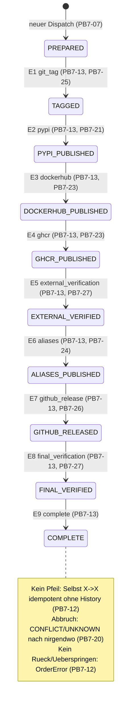

# 07.11 – Veröffentlichung

> **Kapitelstatus:** Intern abgenommen und integriert (INTEGRATED) – Stand Commit a8993c5c68042d996eab680d84a5b138a214bb5d; externe ROOT-Freigabe ausstehend
> **Geltung:** genau Commit `a8993c5c68042d996eab680d84a5b138a214bb5d` (Branch detached)
> **Faktenbasis:** PB7-01 bis PB7-29 aus `workflow/research/07.11.json`; N1–N6, U1–U6, K1–K6
> **Diagramm:** genau ein Mermaid-stateDiagram-v2 E1–E9 (Idee 1 umgesetzt)
> **Abgrenzung:** 07.09 CI-Gates · 07.10 RC/QUALIFIED · 07.07 Merge · 07.08 Build · 07.12 Lieferkette

## 1. Worum geht es?

QUALIFIED rein, COMPLETE raus: kein neuer Build, nur Gates/Publish/State. Vier Jobs tag→pypi→registries→finalize (needs); State 10 Zustände nur vorwärts; REAL-Gates vor erstem Schritt; fail-closed.

Auslösung nur workflow_dispatch (candidate_run_id + version required). Publish = bekannte Dateien/Digests/Tags befördern, nichts neu bauen.

## 2. Das Wesentliche

| Aspekt | Kern | Beleg |
|---|---|---|
| Auslöser | nur dispatch; beide Inputs required | PB7-01 |
| Rechte | {} global; je Job (id-token nur pypi; contents tag/finalize; packages registries/finalize; actions alle) | PB7-02/03 |
| Env | alle 4 release; Reviewer/Wartezeit UNKNOWN (Settings) | PB7-04 |
| Concurrency | release-publish-<version> kein Abbruch; Candidate-Gruppe getrennt | PB7-05 |
| Kette | tag→pypi→registries→finalize | PB7-06 |
| Manifest | rc-manifest.json Schema 3 (1 pro-Eintrag, 2 Plattform-Räder linux_x86_64/win_amd64, cp312); Quali-Berichte + embedded Schema 1 | RC7-11/14 |
| Übergabe | Candidate per run-id merge-multiple; State laufintern ohne run-id (Neu-Dispatch PREPARED) | PB7-07 |
| Gate1 | preflight --require-qualified vor Advance TAGGED | PB7-08 |
| Checks | Version/Notes/sauber/Commit/Tree/Tag/Manifest/QUALIFIED+evidence/Redistribution/Registry-Roots/Pfade/State (FAIL); Tools/Creds/Manifest-Pfad-ohne-Manifest WARN | PB7-09 |
| Gate2 | publish --until TAGGED --yes ohne trusted (Twine ungenutzt) | PB7-10 |
| Ordnung | 10 PREPARED..COMPLETE; INDEX einzige Ordnung | PB7-11 |
| advance | gleich=idempotent ohne History; +1 mit updatedAt+Append; sonst OrderError | PB7-12 |
| Graph | 9 Steps 1:1 (PUBLISH/VERIFY_ONLY/LOCAL); complete ohne Adapter | PB7-13 |
| FIRST_PUBLIC | definiert/exportiert, nirgends referenziert (Gate=TAGGED) | PB7-14 |
| Barrieren | Tag ab PREPARED; Public ab TAGGED; Aliase ab EXTERNAL; Release ab ALIASES | PB7-15 |
| Bindung | Version/Commit/Tree/Dist/Images/Candidate fail-closed; korrupt StateError; atomar; Secret-Check | PB7-16 |
| Plan | nur verkürzt (Filter <=stop_after); unbekannt ValueError; leer wenn überschritten | PB7-17 |
| Boundaries | TAGGED/PYPI_PUBLISHED/EXTERNAL_VERIFIED/COMPLETE testfixiert; publish ohne, dry-run mit choices | PB7-18 |
| REAL-Gates | Redistribution VERIFIED+Revision+evidence; QUALIFIED; evidence vorhanden; Commit/Tree gleich; Dry akzeptiert NOT_QUALIFIED | PB7-19 |
| Fail-closed | Conflict→CONFLICT Abbruch; Unavailable→UNKNOWN (REAL Abbruch DRY weiter); ABSENT+REAL publish+re-verify nur MATCH; MATCH resume; VERIFY_ONLY nicht-MATCH REAL Abbruch DRY pending | PB7-20 |
| PyPI | exakt Namen+SHA via JSON (alle sonst ABSENT; fremd/Mismatch Conflict; Netz Unavailable); trusted ohne Fallback; twine --non-interactive --skip-existing; 1 Distribution (pro) + 2 Wheels (linux/win), kein sdist | PB7-21 |
| Precheck | --manifest --dist-dir --stage-dir upload; upload_pro aus upload/pro; nur upload/pro skip-existing; nur absent pro + lokal sha (Mismatch/fehlend ManifestError) | PB7-22 |
| Registries | Digest-Promotion ohne Build (DockerHub staging@digest --tag version; GHCR dockerhub@digest); verify Remote=manifest sonst Conflict; fehlend/unconfig Unavailable | PB7-23 |
| Aliase | Pre-Release keine; 0.x.y 0.x+latest (kein 0); ≥1 major.minor+major+latest; beide Roots je Variante; verify MATCH alle sonst ABSENT; skip korrekte; leer MATCH | PB7-24 |
| Tag | erster Schritt v<version>; MATCH nur Remote auf sourceCommit; fremd Conflict; unerreichbar Unavailable; annotiert nie force; lokal korrekt ohne Remote = Input | PB7-25 |
| Release | letzter Marker gh view tag/name/isDraft; 404 ABSENT; falsch Conflict; create --title --notes/--generate-notes nach Gate; Token via gh/GH_TOKEN finalize | PB7-26 |
| Aggregate | external pypi+dockerhub+ghcr; final +aliases+tag+release; publish immer ReleaseError | PB7-27 |
| Secrets | nur GITHUB/DOCKERHUB (USER var+TOKEN); GH_TOKEN finalize; kein PYPI/KROKO; Adapter erben Session | PB7-28 |
| CLI | --manifest/--yes Pflicht; Version/Manifest ungleich, !QUALIFIED, fehlend evidence FAILED; dann require_qualified Preflight Adapter Engine until; stoppedEarly Exit1 | PB7-29 |

Merksatz: *QUALIFIED rein, COMPLETE raus – dazwischen nur belegte Gates.*

## 3. Auslöser/Rechte/Env (PB7-01..05)

**Dispatch (PB7-01):** nur workflow_dispatch + beide required (candidate_run_id + version). Kein push/tag/schedule/PR-target. Dispatch-Ref frei wählbar (U5; Tag auf sourceCommit, nicht HEAD K4).

**Rechte (PB7-02/03):** {} global; tag actions+contents:write; pypi +id-token (einzig, kein packages); registries +packages (kein contents:write); finalize beide; alle actions:read + contents. pypi kann nicht taggen/releasen; registries kein Repo.

**Env (PB7-04/N3/U1):** alle 4 release; CI/RC keine. Reviewer/Wartezeit/Branches/self-review UNKNOWN (Settings, kein Code-Gate).

**Concurrency (PB7-05):** version kein Abbruch; Candidate-Gruppe anders (kein Cross-Schutz; Schutz via Identität).

## 4. Kette/Übergabe (PB7-06..08)

**Needs (PB7-06):** tag (ohne) → pypi → registries → finalize. Namen nennen Bereich. Reihenfolge via Boundary, nicht YAML.

**Übergabe (PB7-07/N4):** Candidate per run-id+GITHUB_TOKEN merge-multiple in CANDIDATE_DIR; State artefaktweise ohne run-id (Neu-Dispatch PREPARED; Resume nur via verify MATCH).

**Gate1 (PB7-08):** preflight --manifest --version --require-qualified vor Advance TAGGED (Position testfixiert).

**Manifest (Eingang):** rc-manifest.json Schema 3 (genau 1 pro-Eintrag, 2 Plattform-Räder linux_x86_64/win_amd64, cp312); Abgrenzung: Qualifikations-Berichte identity-qualification-*.json + _embedded_kroko.json = Schema 1 (keine Verwechslung).

## 5. State/Plan (PB7-09..18)

**Checks (PB7-09):** FAIL Identität/Version/Notes/sauber/Commit/Tree/Tag/Manifest/QUALIFIED/evidence/Redistribution/Registry-Roots (GHCR abgeleitet/DockerHub konfiguriert)/Pfade/State; WARN Tools/Creds/Manifest-Pfad-ohne-Manifest.

**Gate2 (PB7-10):** --until TAGGED --yes ohne trusted (Twine-Pfad ungenutzt; Trusted via id-token).

**Ordnung (PB7-11):** 10 PREPARED TAGGED PYPI_PUBLISHED DOCKERHUB_PUBLISHED GHCR_PUBLISHED EXTERNAL_VERIFIED ALIASES_PUBLISHED GITHUB_RELEASED FINAL_VERIFIED COMPLETE.

**advance (PB7-12):** gleich idempotent; +1 History; sonst OrderError. Kein Sprung/Rückweg.

**Graph (PB7-13):** 9 Steps PUBLISH/VERIFY_ONLY/LOCAL; complete LOCAL ohne Adapter. Eine Definition (dry+publish).

**FIRST_PUBLIC tot (PB7-14/K6):** definiert/exportiert, kein Gate; Barriere TAGGED gilt (keine Kante).

**Barrieren (PB7-15):** s.o. Auch außerhalb Engine (Adapter direkt).

**Bindung (PB7-16):** fail-closed lokal (keine Git-Authority); atomar; Secret-Check.

**Plan (PB7-17):** nur Filter; 4 Boundaries erreichen COMPLETE. publish Parser ohne choices (N6; dry-run mit).

**Boundaries (PB7-18):** exakt 4 testfixiert + ORDER.

## 6. Publish-Pfade (PB7-19..29)

**REAL-Gates (PB7-19):** Redistribution VERIFIED+Revision+evidence (kein Override); QUALIFIED; evidence; Commit/Tree; Dry NOT_QUALIFIED ok.

**Fail-closed (PB7-20):** s.o. Matrix (Conflict Abbruch beide; Unknown REAL Abbruch/DRY weiter; ABSENT re-verify nur MATCH; VERIFY_ONLY ohne MATCH REAL Abbruch/DRY pending).

**PyPI (PB7-21/K1):** exakt Namen+SHA JSON (Teil=ABSENT; fremd/Mismatch Conflict; Netz Unavailable); trusted verweigert Fallback; twine skip-existing; 1 Distribution (pro) + 2 Wheels (linux/win), kein sdist. Free/Pro-Kommentare ignorieren (K1).

**Precheck (PB7-22):** staging nur absent pro + sha; upload_pro gating; Action nur true skip-existing; ABSENT stage MATCH skip CONFLICT/UNKNOWN STOP (Exit via pipefail).

**Registries (PB7-23):** Promotion ohne Build; GHCR aus DockerHub-Digest nie Staging; verify=manifest sonst Conflict.

**Aliase (PB7-24):** s.o. Regeln; beide Roots; idempotent; leer MATCH.

**Tag (PB7-25/K5):** v<version> zuerst; Remote-Autorität; annotiert nie force; GitError statt ReleaseError (Exit !=0 bleibt).

**Release (PB7-26):** letzter Marker; gh view; create --title/notes nach Gate.

**Aggregate (PB7-27):** read-only; publish immer Fehler.

**Secrets (PB7-28/U2):** s.o. Tabelle; Adapter erben Session; Existenz UNKNOWN.

**CLI (PB7-29):** s.o. Vertrag; release.py nur Delegation.

## 7. Diagramm E1–E9

Legende E1 Tag (PB7-25) · E2 PyPI (PB7-21/22) · E3 DockerHub (PB7-23) · E4 GHCR (PB7-23) · E5 Aggregat extern (PB7-27) · E6 Aliase (PB7-24) · E7 Release (PB7-26) · E8 Aggregat final (PB7-27) · E9 complete (PB7-13/19). Job/Boundary: E1 tag/TAGGED · E2 pypi/PYPI · E3-5 registries/EXTERNAL · E6-9 finalize/COMPLETE. Eintritt [*]→PREPARED kein Schritt (Neu-Dispatch N4).

Nicht gezeichnet: Reviewer/Approval (U1/N3) · Retry/Notify/Timeout (N5) · Rollback/Yank/Delete (N1/N2) · Zahlen/Dauern · Free-Pro-Trennung (K1) · FIRST_PUBLIC (K6) · docs/release-process (K2) · State-Pfad-Divergenz (K3) · HEAD-vs-sourceCommit (K4) · GitError-vs-ReleaseError (K5).

## 8. Lücken/Konflikte

N1 kein Rollback/Yank/Unpublish · N2 kein Delete · N3 kein Reviewer-Code · N4 kein Resume-Store · N5 kein Retry/Notify/Timeout · N6 until ohne choices. U1 release-Settings · U2 Secrets-Existenz · U3 PyPI-Gegenseite · U4 Branch-Protection · U5 Dispatch-Ref · U6 Overrides. K1 eine Variante · K2 docs-Verweis · K3 State-Pfade · K4 HEAD-vs-source · K5 GitError-Traceback · K6 FIRST_PUBLIC tot.

## 9. Nachweise (alle PB7-IDs)

PB7-01 Trigger · PB7-02 {} · PB7-03 Rechte · PB7-04 env · PB7-05 Concurrency · PB7-06 Kette · PB7-07 Übergabe · PB7-08 Gate1 · PB7-09 Checks · PB7-10 Gate2 · PB7-11 ORDER · PB7-12 advance · PB7-13 Graph · PB7-14 FIRST_PUBLIC · PB7-15 Barrieren · PB7-16 Bindung · PB7-17 Plan · PB7-18 Boundaries · PB7-19 REAL-Gates · PB7-20 Fail-closed · PB7-21 PyPI · PB7-22 Precheck · PB7-23 Registries · PB7-24 Aliase · PB7-25 Tag · PB7-26 Release · PB7-27 Aggregate · PB7-28 Secrets · PB7-29 CLI. Stand a8993c5c. Intern unabhängig geprüft und integriert; externe ROOT-Freigabe ausstehend.

Weiter: [07.09](07.09-ci.md) · [07.10](07.10-release-candidate.md) · [07.12](07.12-buildketten-sicherheit.md).
