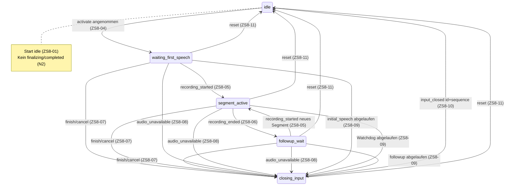

# 08.05 – Zustands-/Phasenkatalog

> **Kapitelstatus:** Intern abgenommen und integriert (INTEGRATED) – Stand Commit a8993c5c68042d996eab680d84a5b138a214bb5d; externe ROOT-Freigabe ausstehend
> **Geltung:** genau Commit `a8993c5c68042d996eab680d84a5b138a214bb5d` (Branch nicht verifizierbar)
> **Faktenbasis:** ZS8-01 bis ZS8-30 + Sollmengen S1–S15 aus `workflow/research/08.05.json`; N1–N5, U1–U5, C1–C6
> **Diagramm:** genau ein Mermaid-stateDiagram-v2 (Idee 1 umgesetzt, nur Activation-Kanten A)
> **Abgrenzung:** Event-Felder 08.01; Commands 08.02; Timing 08.06; Mechanik 02.x/04.x/05.x/07.x nur referenziert.

## 1. Worum geht es?

Mehrere kleine Maschinen, keine Gesamtmaschine. Autorität: Domain activation.py, Wire schema.py nur Spiegel (INPUT_PHASES Kopie, unbekannt→idle). INACTIVE = Alias idle, kein 6. Wert. Genau 5 Vordergrundphasen; finalizing/completed gibt es nicht (finale Transkription = Hintergrund). Window 3 (ohne closing) vs Input 4 (mit); closeRequested = phase==closing. Fallen: INACTIVE vs Recorder-inactive (C2); 5 Phasen vs 5 wakeWord.state-Labels (C3).

| Phase | Bedeutung | Aufnahme |
|---|---|---|
| idle | kein Fenster; neu möglich | nein |
| waiting_first_speech | offen, keine Sprache | ja |
| segment_active | Segment läuft | ja |
| followup_wait | Segment Ende, Anschluss möglich | ja |
| closing_input | Schleuse, kein Aufnahme | nein |

## 2. Sollmengen S1–S15

S1 5 Phasen (idle/waiting/segment/followup/closing) · S2 5 Wire identisch · S3 3 Window (ohne closing) / 4 Input (mit) · S4 4 Deadlines (initial 15.0/followup 3.0/watchdog 600-180-30/recovery 5.0) · S5 4 Aktionen (activate/refresh/finish/cancel) + control 3 + Quellen manual/wake_word · S6 15 Results (accepted applied/no_change) · S7 26+10 Projektion · S8 5 Recorder (inactive/wakeword/listening/recording/transcribing, kein Enum) · S9 2 Policies (legacy/controlled) · S10 4/3 Terminals (Segmente completed/discarded/cancelled/failed; Aktivierungen completed/cancelled/failed) · S11 5 Lizenz (NOT_CHECKED/CHECKING/VALID/INVALID/CHECK_FAILED) · S12 3+2+3 Modell (DISCOVERED/VALIDATED/LOAD_VERIFIED; ready 2; optional 3) · S13 3+5 Verbindung (pre_hello/accepted/closed; 4400/4406/4408/4409/1011; 10.0s) · S14 2/2/3 Scheduler (Lanes main/realtime; kinds final/realtime; Drops coalesced/stale/cancelled) · S15 5 Code-Literale wakeWord.state (waiting_for_wake_word, wake_word_wait_ended, wake_word_detected_waiting_for_voice, wake_word_timeout, recording; ohne Validierung).

## 3. Activation (ZS8-04..12)

**activate (ZS8-04):** Guards source bekannt→IDLE→enabled→id None; sonst trigger_disabled/activation_locked/trigger_disabled/invalid_payload. Dann waiting_first_speech, id/seq+1, frozen Settings/Policy, initial-Timer, version+1.

**started/ended (ZS8-05/06):** waiting|followup→segment_active (neues Segment); segment→already_recording ohne Watchdog-Reset. segment_active→followup_wait (+Timer); closing→input_closing ohne Wechsel; sonst not_active.

**Close (ZS8-07/08):** finish/cancel (quellneutral) Nicht-Idle→closing_input (finished/cancelled, CloseContext frozen); Guards invalid/not_active/stale; closing→no_change. audio_unavailable: jede Nicht-Idle→closing_input (cancelled/audio_unavailable), nicht korreliert; IDLE not_active.

**tick (ZS8-09):** Token 6 Felder exakt sonst stale_timer; Warnung ohne Phasenwechsel (version+1, timerRevision unverändert, gleiches Token gültig); recovery bleibt closing; Timeouts→closing (initial/followup timed_out, watchdog segment_watchdog_timeout ohne Follow-up).

**input_closed (ZS8-10):** closing→idle nur id+sequence passend; Mismatch stale ohne Touch; clear→idle/Timer weg/count 0/Context weg/version+1.

**reset (ZS8-11):** IDLE already_idle; sonst clear→idle; sequence bleibt.

**Zähler (ZS8-12):** sequence nur Aufnahme; version nur effektiv; timerRevision nur Timer-Setzen/Loeschen; token je Segmentstart.

## 4. Reasons/Lücke (ZS8-13/14)

27 offen (23 Literale + finished/cancelled via _begin_input_close, timed_out/segment_watchdog_timeout via _enter_close_barrier; str kein Enum) vs 15 geschlossen (nur applied/no_change accepted). DOMAIN 26→15, NON_COMMAND 10. timed_out + segment_watchdog_timeout in keiner Tabelle (Testregex blind) → kein Ack-Mapping (Timer-intern), aber Event-Projektion activation_closed möglich (U3).

## 5. Weitere Automaten (ZS8-15..30, Text)

Recorder 5 implizit, No-op bei Gleichheit, Callbacks/Spinner; gesetzt Worker/lifecycle/transcription_api (N4). Gate closed|open(id,generation)|shutdown; Guards controlled/Monotonie/Ownership/replace; shutdown sperrt (ZS8-17). Quervalidierung Gate-Token vs Aktivierung vor started (ZS8-30). Wake-Latch binär exactly-once (ZS8-20/21). Ledger Segmente pending/draining→4 Terminals (completed nur Drain; completed verweigert) + Aktivierungen open→input_closed→3 Terminals (terminal+drained; failed>cancelled>completed); discarded nur Segment (ZS8-18/19, C6). Modell DISCOVERED→VALIDATED→LOAD_VERIFIED; Fehler bleibt VALIDATED; refresh neu (U4); Readyness 4 öffentlich (ZS8-22/23). Lizenz 5 mit Token/uuid, Ablauf→CHECK_FAILED, bind→NOT_CHECKED (ZS8-24). Verbindung implizit 3 Stufen, Binär vor Accept 4400 (ZS8-25). Session unbekannt→reserved→active→removed, kein Enum/kein sessionState (N1, ZS8-26). Scheduler Slots+Drops, kein Job-Status (N3, ZS8-27). wakeWord.state 5 Code-Literale ohne Validierung (waiting_for_wake_word, wake_word_wait_ended, wake_word_detected_waiting_for_voice, wake_word_timeout, recording; N5, ZS8-28). Shutdown idempotent ohne Rückweg (ZS8-29).

## 6. Diagramm (nur Kanten A, ZS8-04..11)

Legende A: 5 Knoten ZS8-01 · activate ZS8-04 · started ZS8-05 · ended ZS8-06 · finish/cancel ZS8-07 · audio ZS8-08 · Timeout ZS8-09 · input_closed ZS8-10 · reset ZS8-11. Nur angenommene Transitionen sind Kanten. Keine [*]-Initialkante (nicht in Kantenmenge A; Start als Note).

Nicht gezeichnet: finalizing/completed/transcribing als Phase (N2) · idle→segment_active (Guard not_active ZS8-05) · segment→segment No-op (ZS8-05) · recovery-Schleife (bleibt closing ZS8-09) · closing→segment (ZS8-07/10) · refresh als Kante (nur Fristen, C4) · idle-audio (not_active ZS8-08) · idle-reset (already_idle ZS8-11) · Recorder/Gate/Ledger/Modell/Lizenz/Verbindung/Session/Scheduler (eigene Maschinen ZS8-15..29).

## 7. Lücken/Konflikte

N1 kein Session-Enum/sessionState · N2 keine finalizing/completed · N3 kein Job-Status · N4 keine Recorder-Tabelle · N5 keine wakeWord.state-Validierung. U1 Branch detached · U2 recover-version unentscheidbar · U3 Timeout-Lücke Absicht unentscheidbar · U4 LOAD_VERIFIED Refresh unspezifiziert · U5 reale Timeouts 05.x (nur Defaults). C1 3 vs 4 · C2 INACTIVE vs inactive · C3 5 vs 5 Labels · C4 refresh vs finish/cancel in closing (accepted-falsch/true, beide ohne Wechsel) · C5 27 vs 15 · C6 4 vs 3 Terminals.

## 8. Nachweise (alle IDs)

ZS8-01 Start/5 · ZS8-02 Spiegel · ZS8-03 3 vs 4 · ZS8-04 activate · ZS8-05 started · ZS8-06 ended · ZS8-07 Close · ZS8-08 audio · ZS8-09 tick · ZS8-10 input_closed · ZS8-11 reset · ZS8-12 Zähler · ZS8-13 27 · ZS8-14 26+10/Lücke · ZS8-15 Recorder-Helfer · ZS8-16 Recorder-Quellen · ZS8-17 Gate · ZS8-18 Ledger-Segmente · ZS8-19 Ledger-Aktivierung · ZS8-20 Latch · ZS8-21 logisches Wake · ZS8-22 Modell · ZS8-23 Readyness · ZS8-24 Lizenz · ZS8-25 Verbindung · ZS8-26 Session-Registry · ZS8-27 Scheduler · ZS8-28 Timeline · ZS8-29 Shutdown · ZS8-30 Quervalidierung. S1 5 · S2 5 · S3 3/4 · S4 4 · S5 4/3/2 · S6 15/2 · S7 26+10 · S8 5 · S9 2 · S10 4/3 · S11 5 · S12 3/2/3 · S13 3/5 · S14 2/2/3 · S15 5. Stand a8993c5c. Intern unabhängig geprüft und integriert; externe ROOT-Freigabe ausstehend.

Weiter: [08.01](08.01-event-katalog.md) · [08.02](08.02-command-katalog.md) · [08.06](08.06-timing-katalog.md) · [02.03](../02-funktionsweise/02.03-activation.md).
