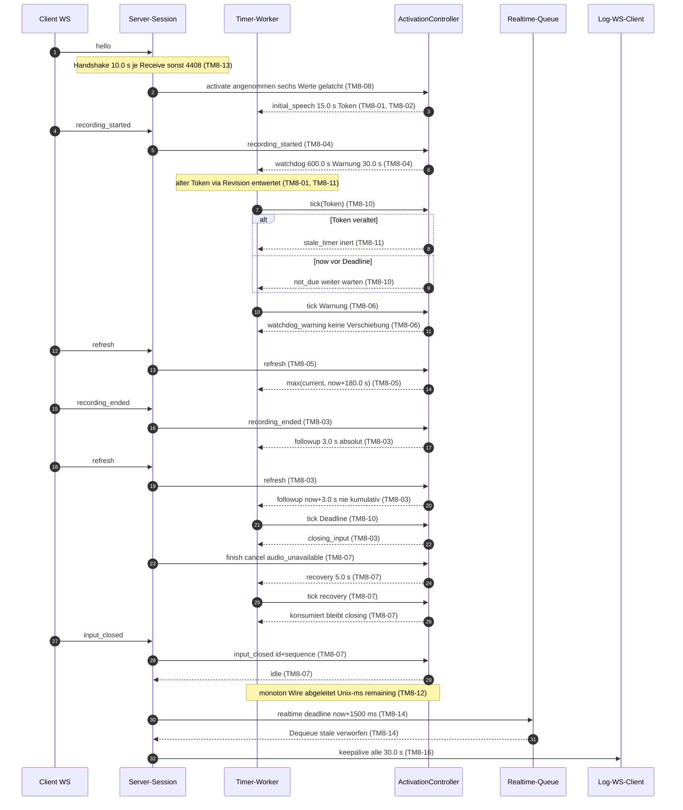

# 08.06 – Timing-Katalog

> **Kapitelstatus:** Intern abgenommen und integriert (INTEGRATED) – Stand Commit a8993c5c68042d996eab680d84a5b138a214bb5d; externe ROOT-Freigabe ausstehend
> **Geltung:** genau Commit `a8993c5c68042d996eab680d84a5b138a214bb5d` (Branch nicht verifizierbar)
> **Faktenbasis:** TM8-01 bis TM8-30 + Sollmengen A–G aus `workflow/research/08.06.json`; N1–N6, U1–U4, C1–C5
> **Diagramm:** genau ein Mermaid-sequenceDiagram (Idee 1 umgesetzt, nur belegte Abläufe)
> **Abgrenzung:** Phasen 08.05; Settings 08.03; Mechanik 02.x/03.x/04.x/05.x nur referenziert.

## 1. Worum geht es?

Vier Deadline-Arten (initial/followup/watchdog/recovery), ein Arm-Punkt (+Revision). Zeitbasis: Controller monotonic, Wire nur abgeleitet (deadlineAtUnixMs/remainingMs); Wanduhr nur Recorder-Legacy + Log-Token. Einheit: Schema ms, Controller s (/1000 zentral). Latch: 6 Werte bei Admission eingefroren; Patch erreicht laufende nicht. Warnung ohne Verschiebung; kein extend/Banking; kein Gesamt-Timeout; kein zweiter Recovery-Timer.

## 2. Sollmengen A–G

A 4 Arten (initial/followup/watchdog/recovery) · B 6 Keys (15000/100/3600000, 3000/100/60000, 600000/60000/3600000, 180000/30000/600000, 30000/5000/kein max, 5000/1000/30000; alle session/next_activation) · C 13 Server (10.0s, 1500ms, 600.0s, 180.0s, 3600.0s, min(30,t/4), 10/3/5/5s, 30.0s, 0.0, 5.0s) · D 2 (WS-keepalive 30.0s, Token 86400s) · E 7 Recorder (5s, 10s, 10s, 0.1s, +0.1s, 0.01s, 0.02s) · F 4 Poll (0.2s, 0.1s, 0.1s, 0.1s; keine Fristen) · G 2 Kroko (5.0s, Lock 1800s/0.05s Tooling).

## 3. Activation (TM8-01..09)

**Arten (TM8-01):** initial/followup/watchdog/recovery; _set_timer_locked einziger Arm (+Revision); Snapshot deadline/deadlineKind/warning/warningFired/token.

**initial 15.0s (TM8-02):** ab Admission; Ablauf timed_out/initial_speech_timeout→closing; refresh invalid_phase.

**followup 3.0s (TM8-03):** bei Ende + refresh absolut now+3, nie kumulativ; kein extend.

**watchdog 600s (TM8-04):** Warnung 30s davor; Fenster>Rest→sofort fällig (max); Ablauf segment_watchdog_timeout→closing (kein Follow-up); VAD kein Reset.

**refresh 180s (TM8-05):** max(current,now+refresh); früh No-op ohne Revision; Warnung neu deadline-warning.

**Warnung (TM8-06):** eigenes Event, keine Verschiebung, Revision unverändert, Token gültig; einmal je Arming.

**recovery 5.0s (TM8-07):** konsumiert, bleibt closing (recoveryRequested); nur input_closed→idle; Fehlschlag terminaler Session-Close. Ein Timer, keine Schleife.

**Latch/ms (TM8-08):** /1000 aus einem Snapshot; 6 Werte bei Admission gelatcht; Patch läuft nicht nach.

**Cross-Field (TM8-09):** warning < initial UND < refresh; je Watchdog-Key gegen finalen Kandidaten; Warning ohne eigenes max (C5).

## 4. Worker/Token/Wire (TM8-10..12)

**Worker (TM8-10):** ein Thread je Token; due=min(warning,deadline); wait; früh→not_due weiter; nach Ablauf return (Warnung läuft weiter).

**Token (TM8-11):** 6 Felder (id/seq/revision/phase/kind/segment); alt→stale_timer inert; ohne Frist→not_expirable; tick(None/nonsense) wirkungslos.

**Wire (TM8-12):** monotonic; remaining=(deadline-now)*1000, deadlineAtUnixMs=wall+remaining; Wanduhr-Sprung ändert nichts.

## 5. Transport/Server (TM8-13..22)

**Handshake 10.0s (TM8-13):** je Receive vor accepted, Close 4408, keine Session; keine Gesamtfrist (U3).

**Realtime 1500ms (TM8-14):** nur realtime, Drop stale beim get; Final ohne Alter. Grenzen Tiefe/Global 8/64 Ablehnung.

**OpenAI 600.0s (TM8-15/B):** TimeoutError + cancel; Aufrufer ohne Wert; SSE ohne Keepalive (Poll 0.1s).

**Log-WS 30.0s (TM8-16/C1/N4):** log.keepalive im WS; SSE ohne Keepalive. Client-ping→pong.

**Token 86400s (TM8-17):** Wall-Clock, Sweep ab 1024, volatil; Neustart entwertet.

**Idle 3600s (TM8-18):** Intervall min(30,t/4); unload verschiebbar bei Audio; lifecycle idleSecondsRemaining.

**Laden 180s (TM8-19/B):** TimeoutError; wait_ready(None) unbegrenzt.

**Joins (TM8-20/B):** Engine 10s, ready/idle je 5s, text 3s; keine Domäne.

**Audio-Deckel 30.0s (TM8-21/B):** 30*16000 Samples→Zwangs-Finalisierung; Budget kein Timer.

**Wake-Fenster 0.0=aus (TM8-22/B):** >0 sleep+Generation+timeout-Event; nicht Activation-Follow-up.

## 6. Wake/Recorder/Kroko/Query/Poll (TM8-23..30)

**V2-Wake-Timeout 5.0 unwirksam (TM8-23/C4/N5):** durchgereicht, bei Evaluator übersprungen; nur Legacy.

**cooldown 0 (TM8-24/N6):** min0/ohne max/monoton/nach Close; WW-18 EVIDENCE_BLOCKED.

**preRoll 0 (TM8-25/N6):** Clamp auf Historie (preRollClamped); WW-19 EVIDENCE_BLOCKED.

**Kroko 5.0s (TM8-26/B):** je Roundtrip, kein Retry.

**Query 0.01–3600s (TM8-27/C2):** nur Fallback ohne timing_policy; sonst Bundle; Registry strikt autoritativ.

**Poll keine Fristen (TM8-28/N4):** 0.2/0.1s Aufwachintervalle, keine Übergänge.

**Infra (TM8-29):** pipe 5s, joins 10/10s, safepipe 0.1/+0.1s, queue 0.01s, waits 0.02s.

**Defaults (TM8-30):** boundary (0.05,0.2), silence 0.2, preroll 200/160/600/80ms, audio 0.25/20.0s; nur Katalog.

## 7. Diagramm (nur belegte Abläufe)

Legende: hello/Handshake TM8-13 · activate/Latch TM8-08 · initial TM8-02 · started/watchdog TM8-04 · Token TM8-11 · tick/not_due TM8-10 · Warnung TM8-06 · refresh TM8-05 · ended/followup TM8-03 · closing/recovery TM8-07 · input_closed TM8-07 · monoton/Wire TM8-12 · realtime TM8-14 · keepalive TM8-16. Kanten 1-22 faktenbelegt (Faktenakte); E21/E22 (Token-TTL/Modell-Idle) nur Text (globale Zyklen).

Nicht gezeichnet: extend/Banking (N1) · Gesamt-Timeout (N2) · zweiter Recovery-Timer (N3) · SSE-Keepalive (N4/C1) · V2-Wake-Timeout (N5/C4) · Poll-Fristen (TM8-28) · Token-TTL/Modell-Idle als Activation-Kanten (globale Zyklen TM8-17/18) · Query-Fallback (TM8-27).

## 8. Lücken/Konflikte

N1 kein extend · N2 kein Gesamt-Timeout · N3 kein zweiter Recovery · N4 kein SSE-Keepalive · N5 V2-Wake-Timeout übersprungen · N6 cooldown/preRoll EVIDENCE_BLOCKED. U1 ~15ms Kommentar · U2 Warnung bei Rest<Warnung nach Refresh ungetestet · U3 Handshake-Neuarmung ungetestet · U4 activation_delay>0 nicht als Frist. C1 30s WS nicht SSE · C2 Registry vs Query · C3 monoton vs Wall · C4 wake_timeout vorhanden/wirkungslos · C5 Warning ohne max.

## 9. Nachweise (alle IDs)

TM8-01 4 Arten · TM8-02 15s · TM8-03 3s · TM8-04 600/30s · TM8-05 180s · TM8-06 Warnung · TM8-07 5s · TM8-08 Latch/ms · TM8-09 Cross-Field · TM8-10 Worker · TM8-11 Token · TM8-12 monoton/Wire · TM8-13 10s · TM8-14 1500ms · TM8-15 600s · TM8-16 30s · TM8-17 86400s · TM8-18 3600s · TM8-19 180s · TM8-20 Joins · TM8-21 30s-Deckel · TM8-22 0.0-Fenster · TM8-23 5.0 Legacy · TM8-24 cooldown · TM8-25 preRoll · TM8-26 5s Kroko · TM8-27 Query-Fallback · TM8-28 Poll · TM8-29 Infra · TM8-30 Defaults. A 4 · B 6 · C 13 · D 2 · E 7 · F 4 · G 2. Stand a8993c5c. Intern unabhängig geprüft und integriert; externe ROOT-Freigabe ausstehend.

Weiter: [08.05](08.05-zustands-phasenkatalog.md) · [08.03](08.03-settings-katalog.md) · [02.03](../02-funktionsweise/02.03-activation.md) · [08.01](08.01-event-katalog.md).
