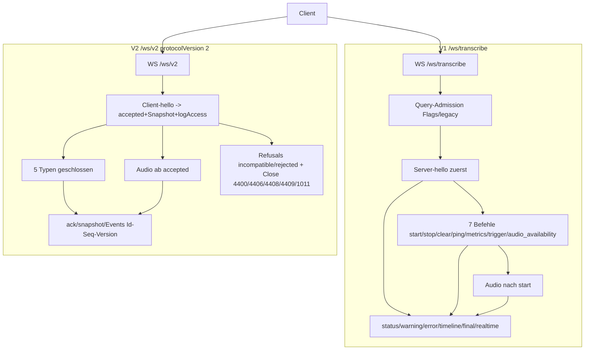

# 09.03 – V1-/V2-Unterschiede

> **Kapitelstatus:** Intern abgenommen und integriert (INTEGRATED) – Stand Commit a8993c5c68042d996eab680d84a5b138a214bb5d; externe ROOT-Freigabe ausstehend
> **Geltung:** genau Commit `a8993c5c68042d996eab680d84a5b138a214bb5d` (Branch nicht verifizierbar)
> **Faktenbasis:** VV9-01 bis VV9-21 aus `workflow/research/09.03.json`; N1–N4, U1–U4, C1–C3
> **Diagramm:** genau ein Mermaid-flowchart (Idee 1 umgesetzt, nur belegte Knoten/Kanten)
> **Abgrenzung:** Mechanik 02.x/04.x/08.x nur referenziert; Migration 09.04; Vertraege 09.05.

## 1. Worum geht es?

Zwei Routen im selben Prozess: /ws/transcribe (Kompatibilitaet) + /ws/v2 (Protokoll 2, nicht im ConnectionManager). V1 offen/tolerant (7 Befehle, error-Antwort); V2 geschlossen/versioniert (5 Typen, keine Antwort bei unbekannt). Keine Migration (IDs nicht ueberfuehrbar); kein gemeinsamer Sitzungsspeicher.

## 2. Annahme/Hello/IDs (VV9-01..06)

**Routen (VV9-01):** v1 /ws/transcribe (manager), v2 /ws/v2 (nur ProtocolV2Connection).

**Admission (VV9-02):** v1 Query-Flags (legacy ohne Flags); v2 nur hello, Trigger Pflicht.

**Hello (VV9-03):** v1 Server-hello zuerst (settings/capabilities/limits/logAccess); v2 Client-hello Pflicht sonst 4400, Antwort hello.accepted + Snapshot + logAccess.

**IDs (VV9-04/05):** Session v1 32-hex, v2 kanonische UUID (kompakt invalid); Aktivierung/Segment folgen Sessionform (v1 hex, v2 canonical_ids).

**commandId (VV9-06):** v1 freier String; v2 nur kanonische UUID sonst kein Ack/Slot.

## 3. Befehle/Ack/Fehler (VV9-07..12)

**7 vs 5 (VV9-07):** v1 start/stop/clear/ping/metrics/trigger/audio_availability; v2 5 geschlossen. Unbekannt v1 error, v2 gar nichts.

**Envelope (VV9-08):** v1 ohne version/Bindung; v2 version 2 + passende ID sonst invalid/stale.

**Aktion (VV9-09):** v1 trim/lower, wake_word ok, source bei Control ignoriert (nicht Replay-Key); v2 literal nur manual, Control ohne source (im Replay-Key).

**Ack (VV9-10):** v1 trigger_ack/audio_ack offener reason; v2 ack 10+errors, 15 Codes, accepted nur applied/no_change, Unmapped laut.

**Fehler (VV9-11/N3):** v1 error/warning-Typen; v2 keine error/warning-Typen; Fehler via ack-Result, protocol.incompatible/session.rejected + Close.

**Close (VV9-12/N1):** v1 1008 Config/1013 Limit/1011 Init; v2 4400/4406/4408 10s/4409/1011; kein Keepalive/Idle nach accepted. 1011 gemeinsam.

## 4. Events/Versionen/Settings/Audio/Replay/logAccess/Wake/Capabilities/Verhandlung (VV9-13..21)

**Events (VV9-13):** v1 timeline-Umschlag; v2 kanonisch (cancelled→discarded). Mapping Autoritaet.

**Versionen (VV9-14):** nur v2 eventId/eventSeq/stateVersion + Snapshot/Ack-Felder; v1 ohne. stateVersion != Controller.

**Settings (VV9-15/U3):** v1 hello + global config; v2 patch baseRevision + changed Policy + REST v2. Revision Session.

**Audio (VV9-16):** Format gleich (Decoder); v1 nach start mit warning/error, v2 ab accepted vorher 4400 defekt still.

**Replay (VV9-17):** ein Cache; v2 memo Originalversionen kein Anstieg; Konflikt conflict.

**logAccess (VV9-18/B/C3):** beide Token-Autoritaet; v2 nur Bootstrap accepted.

**Wake (VV9-19):** v1 tolerant Fallbacks; v2 kanonisch atomar alles-oder-nichts.

**Capabilities (VV9-20):** v1 sessionCapabilities/Triggers; v2 wakeWordCapabilities + supported [2].

**Verhandlung (VV9-21/N4):** v1 keine; v2 genau (2,) max gemeinsam, v1-only incompatible+4406.

## 5. Diagramm (nur belegte Kanten)

Legende: Routen VV9-01 · Admission VV9-02 · hello VV9-03 · Befehle VV9-07 · ack VV9-10 · Close VV9-12 · Verhandlung VV9-21 · Events VV9-13/14 · Audio VV9-16. Kanten VV9-01/02/03/07/10/12/13/14/16/21 (Faktenakte 16 Kanten).

Nicht gezeichnet: Phasen (Domäne 08.05) · Zeiten/Mengen (10s nur Text, nicht Diagramm; ausser Close-Codes keine Zahlen) · Threads/Queues · Settings-Mechanik (08.03) · Phasenübergänge.

## 6. Lücken/Konflikte

N1 kein V2-Keepalive/ping/Idle · N2 kein v2 start/stop/clear · N3 kein v2 error/warning · N4 keine Verhandlung >2. U1 Branch · U2 produktive v1-Nutzung · U3 baseRevision-Client · U4 clear-Absicht Kommentar. C1 extend nur V1-Alias; V2-Antwort invalid_payload · C2 ports-Marker historisch (echte Transaktion gilt) · C3 logAccess Bootstrap vs Snapshot-Umfang.

## 7. Nachweise (alle VV-IDs)

VV9-01 Routen · VV9-02 Admission · VV9-03 hello · VV9-04 Session-ID · VV9-05 Aktivierung/Segment · VV9-06 commandId · VV9-07 7/5 · VV9-08 Envelope · VV9-09 Aktion · VV9-10 Ack · VV9-11 Fehler · VV9-12 Close · VV9-13 Events · VV9-14 Versionen · VV9-15 Settings · VV9-16 Audio · VV9-17 Replay · VV9-18 logAccess · VV9-19 Wake · VV9-20 Capabilities · VV9-21 Verhandlung. Stand a8993c5c. Intern unabhängig geprüft und integriert; externe ROOT-Freigabe ausstehend.

Weiter: [09.04](09.04-client-migration.md) · [09.05](09.05-kompatibilitaetsvertraege.md) · [04.12](../04-schnittstellen/04.12-legacy-v1.md) · [08.10](../08-referenzen/08.10-websocket-schema-referenz.md).
