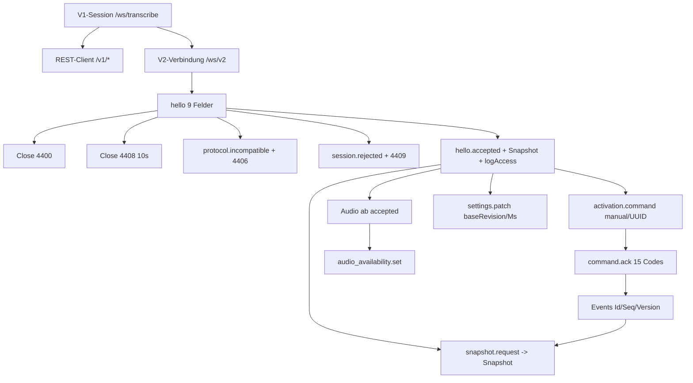

# 09.04 – Client-Migration

> **Kapitelstatus:** Intern abgenommen und integriert (INTEGRATED) – Stand Commit a8993c5c68042d996eab680d84a5b138a214bb5d; externe ROOT-Freigabe ausstehend
> **Geltung:** genau Commit `a8993c5c68042d996eab680d84a5b138a214bb5d` (Branch nicht verifizierbar)
> **Faktenbasis:** MG9-01 bis MG9-24 aus `workflow/research/09.04.json`; E1–E16, N1–N6, U1–U5, C1–C4
> **Diagramm:** genau ein Mermaid-flowchart (Idee 1 umgesetzt, nur belegte Knoten/Kanten)
> **Abgrenzung:** Unterschiede 09.03; Vertraege 09.05; Mechanik 02.x/04.x/08.x nur referenziert.

## 1. Worum geht es?

Ein Prozess, zwei Vertraege (/ws/transcribe + /ws/v2); v1 required compatibility path. Keine Auto-Migration (IDs/Sitzung nicht uebernehmbar); stufenweise pro Client. V1 tolerant/offen (7 Befehle, error-Antwort); V2 geschlossen/versioniert (5 Typen, strenge Pflichten, still bei unbekannt).

## 2. Annahme/Hello/IDs/Urteile (MG9-01..09)

**Routen (MG9-01):** v1 /ws/transcribe (manager), v2 /ws/v2 (nur ProtocolV2Connection).

**Admission (MG9-02):** v1 Query-Flags (legacy ohne Flags); v2 nur Client-hello, Trigger Pflicht.

**Hello (MG9-02/05/18/23):** v1 Server-hello zuerst (settings/capabilities/limits/logAccess); v2 Client-hello Pflicht sonst 4400, Antwort hello.accepted + Snapshot + logAccess.

**IDs (MG9-03):** Session v1 32-hex, v2 kanonisch UUID (kompakt invalid); keine Migration.

**commandId (MG9-12):** v1 freier String; v2 nur UUID sonst kein Ack/Slot (stiller Deadlock statt Fehler).

**Urteile (MG9-06/07/08/09):** incompatible+4406/rejected+4409/4400/4408 10s/1011; Trigger/Wake-Pflicht (sonst 4409); Katalog-IDs kanonisch atomar. Nur Version 2.

## 3. Befehle/Ack/Fehler (MG9-10/11/13/21)

**5 vs 7 (MG9-10/N1):** v2 nur activation.command/trigger_suppression.set/audio_availability.set/session_settings.patch/session.snapshot.request; kein start/stop/clear/ping/metrics. Unbekannt v1 error, v2 still.

**Aktion (MG9-11/C1/C3):** v2 activate nur manual ohne ID; Control ohne source mit UUID; wake_word nie Client. extend existiert nicht (auch v1 nicht, N5; V2-Antwort invalid_payload).

**Ack (MG9-13):** v1 trigger_ack offen; v2 ack 15 Codes, accepted nur applied/no_change. Neue Versionsfelder.

**Fehler (MG9-06/21):** v1 error/warning + 1008/1013; v2 keine generischen error-Typen. Fehler via ack-Result, protocol.incompatible/session.rejected + Close; unparsebar/unbekannt still (eigene Timeouts noetig).

## 4. Events/Settings/Audio/logAccess/Wake/Controlled/Capabilities (MG9-09/14..20/22..24)

**Events (MG9-15/16):** v1 timeline ohne Seq/Version; v2 kanonisch Id/Seq/Version/Zeit; Umbenannt refreshed->phase_changed/closed->input_closed/started->accepted.

**Settings (MG9-17):** v2 patch baseRevision + Ms-Keys; Konflikt; v1 Sekunden-Query/config.

**Snapshot (MG9-18):** request -> Ack + Snapshot (Version/Seq/input/pending/trigger/Settings/Wake); v1 metrics. Resync-Autoritaet.

**Audio (MG9-20/04):** Format gleich (4B LE+JSON+pcm_s16le); v1 nach start mit warning/error; v2 ab accepted. Vor accepted 4400; defekt still (eigene Timeouts nötig).

**logAccess (MG9-20):** beide Token-Autoritaet; v2 nur Bootstrap.

**Wake (MG9-09):** v1 tolerant Fallbacks; v2 kanonisch atomar (nur Katalog-IDs, kein Fallback).

**Controlled (MG9-19):** v2 immer controlled (ActivationController); v1 ohne Flags legacy ohne Controller/Phasen.

**Capabilities (MG9-23):** v1 sessionCapabilities/Triggers; v2 Snapshot-Felder wakeWordCapabilities + supportedProtocolVersions [2] + REST.

## 5. Diagramm (nur belegte Kanten E1–E16)

Legende: Routen MG9-01 · Admission MG9-02 · hello MG9-05 · Befehle MG9-10 · ack MG9-13 · Close MG9-06 · Events MG9-15/16 · Versionen MG9-07/24 · Settings MG9-17 · Audio MG9-20 · logAccess MG9-20 · Wake MG9-09 · Controlled MG9-19 · Capabilities MG9-23. Kanten E1-E16 wie Faktenakte.

Nicht gezeichnet: Phasen (Domäne) · Zeiten/Mengen (10s nur Text, nicht Diagramm; ausser Close-Codes keine Zahlen) · Queues/Threads · Settings-Mechanik · V1-Fehlerframes als V2-Kanten · Resume (N6) · stop/clear/ping/metrics-Knoten (N1) · ready-Frames (N2) · keine Wire-Felder limits/engines/runtime (N3) · keine ID-Migration (N4) · extend-Knoten (N5).

## 6. Lücken/Konflikte

N1 kein stop/clear/ping/metrics · N2 kein ready/Startup-Frames · N3 keine Wire-Felder limits/engines/runtime · N4 keine ID-Migration · N5 kein extend (auch v1 nicht) · N6 kein Resume. U1 Deprecation-Zeitplan · U2 Timeout-Konfigurierbarkeit · U3 limits via v1-REST Absicht · U4 1011-Verhalten · U5 Wake-Backend Absicht. C1 extend nur V1-Alias; V2-Antwort invalid_payload · C2 V1-Zweitnamen nicht v2 · C3 wake_word Quelle · C4 Branch nur Auftrag.

## 7. Nachweise (alle MG-IDs)

MG9-01 Routen · MG9-02 Admission · MG9-03 IDs · MG9-04 start/accepted · MG9-05 hello 9 · MG9-06 Close · MG9-07 Version 2 · MG9-08 Trigger · MG9-09 Katalog · MG9-10 5/7 · MG9-11 Aktion · MG9-12 commandId · MG9-13 ack · MG9-14 audio_availability · MG9-15 Events · MG9-16 Umbenannt · MG9-17 Settings · MG9-18 Snapshot · MG9-19 controlled · MG9-20 Audio/logAccess · MG9-21 still · MG9-22 REST · MG9-23 accepted-Umfang · MG9-24 Version/Commit. Stand a8993c5c. Intern unabhängig geprüft und integriert; externe ROOT-Freigabe ausstehend.

Weiter: [09.03](09.03-v1-v2-unterschiede.md) · [09.05](09.05-kompatibilitaetsvertraege.md) · [04.12](../04-schnittstellen/04.12-legacy-v1.md) · [08.10](../08-referenzen/08.10-websocket-schema-referenz.md).
