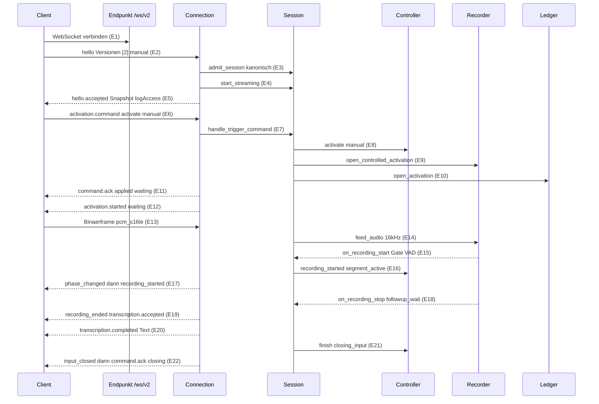

# 09.06 – Beispielszenarien

> **Kapitelstatus:** Intern abgenommen und integriert (INTEGRATED) – Stand Commit a8993c5c68042d996eab680d84a5b138a214bb5d; externe ROOT-Freigabe ausstehend
> **Geltung:** genau Commit `a8993c5c68042d996eab680d84a5b138a214bb5d` (Branch nicht verifizierbar)
> **Faktenbasis:** SZ9-01 bis SZ9-41 + E1–E22 aus `workflow/research/09.06.json`; N1–N4, U1–U4, C1
> **Diagramm:** genau ein Mermaid-sequenceDiagram (Idee 1 umgesetzt, nur belegte Kanten E1–E22)
> **Abgrenzung:** Mechanik 02.x/04.x/08.x nur referenziert; v1 09.03; Migration 09.04.

## 1. Worum geht es?

Nur Szenario A (manuelle v2-Activation hello bis input_closed) überwiegend A-belegt (SZ9-01..23,25,26 A, SZ9-24 B). B Settings-Patch (SZ9-33..35) + C Wake (SZ9-36..39) nur referenziert. Kette: verbinden/hello/activate/Audio/finish. Keine Dauern (U3).

## 2. Szenario A (SZ9-01..26)

**Verbindung/Admission (SZ9-01/02/05..08):** v1 Query + Server-hello; v2 erst nach Client-hello. v2 kein start (start_streaming atomar bei Admission). Handshake 10.0s → 4408. hello-Pflicht + Version; Refusals 4400/4406/4409. admit kanonische UUID; Limit 4409, Fehler 1011. accepted = Snapshot (ohne type) + logAccess + Identitaet.

**Envelope/Replay/activate (SZ9-09..12):** commandId/sessionId kanonisch, version 2, activate nur source=manual. Replay-Lookup vor Phasenmatrix (frozen result). Nur aus idle → waiting_first_speech + Id/Seq/Deadline/version+1. Gate- + Ledger-Open vor Ack; activation_started gesammelt.

**Ack/started (SZ9-13/14):** ack accepted nur applied/no_change; u.a. Felder commandId/accepted/result/activationId/inputPhase/stateVersion/settingsRevision (+protocolVersion/sessionId). started u.a. activationId/activationSequence/primarySource/inputPhase=waiting_first_speech/effectiveSettings.

**Audio/VAD/Segment (SZ9-04/15..18):** Frame 4B + JSON (Pflicht-Metadaten sampleRate/channels, frames-geprüft) + pcm_s16le (16 kHz resampelt); vor accepted 4400. decode/ingest/feed. Aufnahme nur Gate offen + VAD. on_start → segment_active + accept + recording_started. phase_changed vor recording_started (fest).

**Ende/Transkription (SZ9-19..21):** on_stop → followup_wait + recording_ended (reason/Seq). accepted (v1 started) vor Inferenz. Final → completed mit Text.

**finish/Close (SZ9-22..26):** finish → closing_input + Context + Recovery + version+1. Ack closing_input mit Eintritts-Version. Reihenfolge: input_closed VOR finish-Ack (B). Order: Gate-Close/Flush/Ledger-Close/Reserve/input_closed→idle/Publish. input_closed reason/causedBy (nur finish/cancel)/count/exactly once. completed nur via Ledger-Drain (live nicht erzwungen, weglassen).

## 3. Invarianten (SZ9-28..30/40/41)

5 Phasen Normalfolge idle/waiting_first_speech/segment_active/followup_wait/closing_input/idle; kein finalizing. Defaults 15s initial / 3s followup / 600s+180s+30s watchdog / 5s recovery gelatcht pro Activation (Zuordnung 08.06). Ablauf → closing_input (timed_out/watchdog), nie Fehlerphase. stateVersion monoton, eventSeq lueckenlos, = last+1. Ablehnung beendet nicht; ohne kanonische ID kein Ack.

## 4. Abgrenzung B/C/v1 (SZ9-31..39)

**v1 (SZ9-31/32):** hello/start/trigger/ack/recording/final/finish. Ohne start stream_not_started; ohne streaming Audio abgewiesen. Ohne Flags legacy; trigger → controlled_activation_disabled.

**B Patch (SZ9-33..35):** Envelope/Revision/atomar → revision+1; ein Patch = ein Sprung + settings.changed je Gruppe. next_activation erst naechste Activation.

**C Wake (SZ9-36..39):** kanonische IDs atomar sonst ganz abgelehnt. Detection = Trigger via activate(wake_word). detected einmal; Latch-Freigabe erst input_closed. Danach identischer Pfad (Test).

## 5. Diagramm (nur E1–E22)

Legende: E1 SZ9-05 · E2 SZ9-06 · E3 SZ9-07 · E4 SZ9-02 · E5 SZ9-08 · E6 SZ9-09 · E7 SZ9-10 · E8 SZ9-11 · E9 SZ9-12 · E10 SZ9-12 · E11 SZ9-13 · E12 SZ9-14 · E13 SZ9-04 · E14 SZ9-15 · E15 SZ9-16 · E16 SZ9-17 · E17 SZ9-18 · E18 SZ9-19 · E19 SZ9-19/20 · E20 SZ9-21 · E21 SZ9-22/25 · E22 SZ9-23/24/26 (Event vor Ack).

Nicht gezeichnet: activation.completed (SZ9-27/U4) · start/stop/clear/ping/metrics (N1/N4) · closing-Eintritt Event (N2) · finalizing/Fehlerphase (N3/SZ9-30) · Zeiten/Dauern (U3, nur Defaults Text) · interim · Patch/Wake-Kanten (B/C) · E11/E12-Relation (nicht festgelegt) · E19-Innenreihenfolge (nicht zugesichert).

## 6. Lücken/Konflikte

N1 kein start/5 Typen · N2 kein closing-Event, nur stateVersion-Sprung · N3 kein finalizing/5 Phasen · N4 kein stop/clear/ping/metrics. U1 Branch · U2 Gate gleicher Code, v2-Test fehlt · U3 Latenzen · U4 completed/Drain. C1 kein Widerspruch (Event zuerst).

## 7. Nachweise (alle SZ-IDs)

SZ9-01 Endpunkte · SZ9-02 kein start · SZ9-03 v1-Gates · SZ9-04 Frame · SZ9-05 10s/4408 · SZ9-06 hello/Refusals · SZ9-07 admit · SZ9-08 accepted · SZ9-09 Envelope · SZ9-10 Replay · SZ9-11 activate · SZ9-12 Gate/Ledger · SZ9-13 ack · SZ9-14 started · SZ9-15 Audio/4400 · SZ9-16 Gate/VAD · SZ9-17 segment_active · SZ9-18 Reihenfolge · SZ9-19 followup/ended · SZ9-20 accepted · SZ9-21 completed · SZ9-22 finish · SZ9-23 Ack-Version · SZ9-24 Event-vor-Ack · SZ9-25 Order · SZ9-26 input_closed · SZ9-27 Drain · SZ9-28 5 Phasen · SZ9-29 Defaults/Latch · SZ9-30 kein Fehler · SZ9-31 v1-Folge · SZ9-32 legacy · SZ9-33 Patch · SZ9-34 ein Sprung · SZ9-35 Latch · SZ9-36 Wake-Admission · SZ9-37 Trigger · SZ9-38 einmal/Latch · SZ9-39 identisch · SZ9-40 monoton/lueckenlos · SZ9-41 kein Close. Stand a8993c5c. Intern unabhängig geprüft und integriert; externe ROOT-Freigabe ausstehend.

Weiter: [09.03](09.03-v1-v2-unterschiede.md) · [09.04](09.04-client-migration.md) · [02.03](../02-funktionsweise/02.03-activation.md) · [08.05](../08-referenzen/08.05-zustands-phasenkatalog.md).
