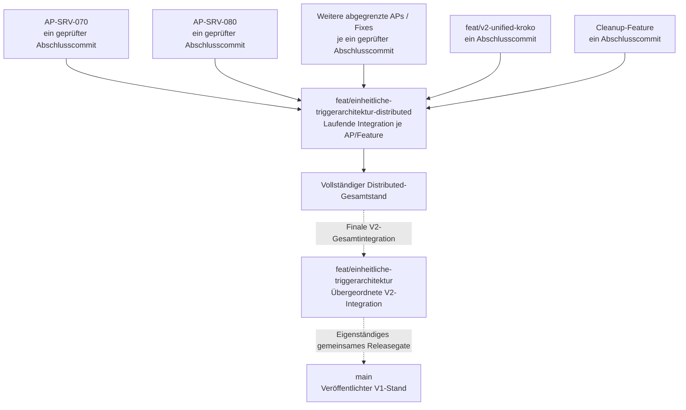
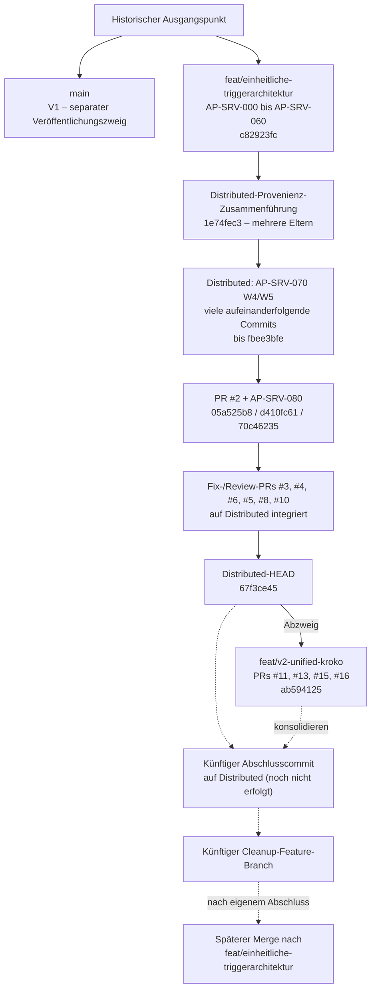
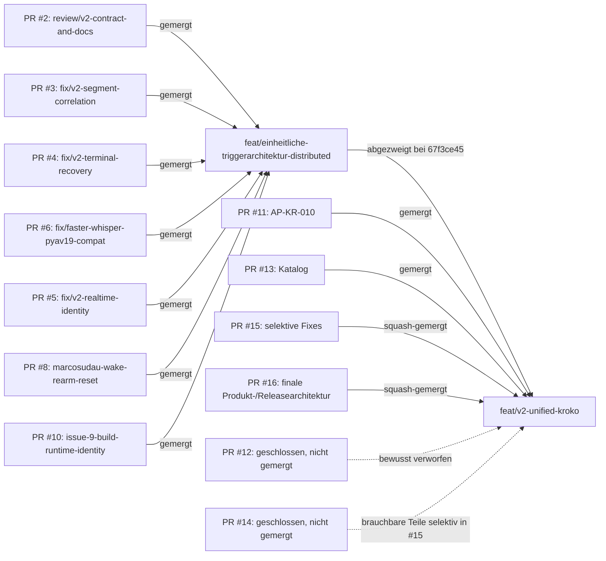
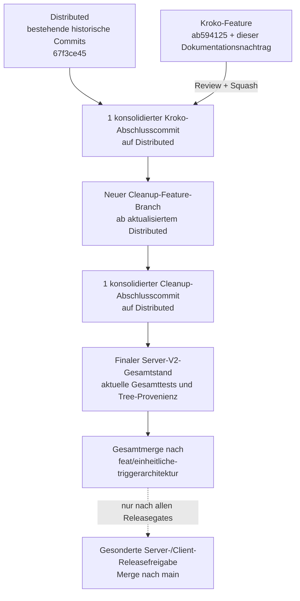

# Voice-STT Server V2 – Branch-Historie, Integrationsabweichung und Fortsetzung

> **Dokumenttyp:** Aktuelle, dauerhaft lesbare Einordnung eines historischen Git-/Prozessbefunds; **keine neue Build-, Release- oder Architekturautorität**.  
> **Stand der Untersuchung:** 28.10.2026. **Repository:** [voice-stt-server](https://github.com/marcosudau-vps/voice-stt-server).  
> **Gegenstand:** `feat/einheitliche-triggerarchitektur`, `feat/einheitliche-triggerarchitektur-distributed`, `feat/v2-unified-kroko`, AP-SRV-000 bis AP-SRV-080 sowie nachfolgende Korrektur-/Featurearbeiten.  
> **Wichtig:** Historische Commits und Archivakten bleiben unverändert. Diese Datei dokumentiert den Befund, die nachweisbaren Grenzen und die künftig einzuhaltende Vorgehensweise. Der später beginnende Cleanup darf diese Einordnung aktualisieren oder an einen geeigneten dauerhaften Dokumentationsort verweisen, darf die historische Tatsache aber nicht stillschweigend umdeuten.

## Kurzfassung – worin bestand der Fehler?

**Es wurde kein AP-SRV-070-Code „vergessen“ oder bei einem Merge zurückgelassen.** Nach AP-SRV-060 wechselte vielmehr die tatsächliche **Integrationspraxis**, ohne dass der zuvor verwendete **organisatorische Abschlussmodus pro Arbeitspaket** konsequent weitergeführt wurde:

1. **Bis einschließlich AP-SRV-060** besitzt `feat/einheitliche-triggerarchitektur` eine erkennbare Folge einzelner, konsolidierter AP-Commits (letzter: `c82923fc`).
2. **Am 29.08.2026** entstand auf `feat/einheitliche-triggerarchitektur-distributed` der mehrparentige Konsolidierungscommit `1e74fec309`, der die Arbeits- und Korrekturhistorie bis AP-SRV-060 zusammenführte. Danach entstanden weitere fachliche Arbeiten direkt auf Distributed.
3. **AP-SRV-070** wurde auf Distributed über viele W4-/W5-Implementierungs- und Korrekturcommits fortgesetzt; ein eigener, eindeutiger **kanonischer AP-SRV-070-Gesamtcommit auf `feat/einheitliche-triggerarchitektur`** wurde nicht erzeugt. Die Akte weist später für die W5-Ziele „vollständig“ aus, während das Archivregister AP-SRV-070 weiterhin als „In Umsetzung / Root Review ausstehend“ bezeichnet.
4. **Nach AP-SRV-070** entstanden eigenständige Arbeiten, namentlich AP-SRV-080 und mehrere separate Fix-, Dokumentations-, Identitäts- und Build-PRs, ebenfalls auf Distributed. **Diese nachfolgenden Arbeiten sind keine bloße Fortsetzung von AP-SRV-070.** Der Fehler darf deshalb nicht als „alles war ein einziges immer größer werdendes AP-SRV-070“ umetikettiert werden.
5. **Unified Kroko** wurde später korrekt als eigener Feature-Branch von Distributed (`67f3ce45`) abgezweigt und intern über PRs #11, #13, #15 und #16 entwickelt. Nach Root-Review wurde PR #16 auf `feat/v2-unified-kroko` gesquasht (`ab594125`).
6. **Git-Abstammung beweist**, dass der letzte explizite AP-SRV-070-W5-Commit `fbee3bfea2` sowohl Vorfahr von Distributed (`67f3ce45`) als auch des Kroko-Featurestands (`ab594125`) ist. Nicht jeder damals geschriebene Code muss heute unverändert sein; spätere Änderungen haben ihn fortentwickelt. **Der Implementierungsstand ist nicht verlorengegangen.**
7. **Bewusste Entscheidung:** Keine rückwirkenden Rebases, Force-Pushes, künstlichen Nach-Merges oder Neuschreibungen alter Prüfakten. Historische Abweichung transparent stehen lassen; weitere Features ab jetzt kontrolliert als **jeweils ein abgeschlossener Gesamtcommit** in Distributed integrieren.

**Der eigentliche „Schuh drückt“ also hier:** Die *fachliche Fertigstellung* und die *formale Abnahme-/Git-Integrationsgrenze* wurden ab AP-SRV-070 nicht mehr durchgehend zusammengeführt. Die späteren 84 Commits vor dem übergeordneten Branch sind nicht automatisch 84 unerledigte Implementierungen, sondern historisch erhaltene Arbeits-, Korrektur- und Merge-Commits. Ein Commitzählwert ist kein Maß für fehlende Funktionalität oder mangelnde Abnahme.

## 1. Verbindliche Branch-Rollen und Integrationsrichtung

| Ebene | Branch | Rolle und zulässige Integration |
| --- | --- | --- |
| Veröffentlicht | `main` | Aktueller V1-Produktstand. V2 erst nach gemeinsamer, gesonderter Releasefreigabe. |
| Übergeordnet V2 | `feat/einheitliche-triggerarchitektur` | Übernimmt **am Ende** den fertiggestellten Distributed-Gesamtstand kontrolliert. Nicht das Ziel jedes neuen Unter-APs während der laufenden Distributed-Phase. |
| Laufende V2-Integration | `feat/einheitliche-triggerarchitektur-distributed` | Nimmt einzeln freigegebene und **konsolidierte** Arbeitspaket-/Feature-Abschlusscommits auf; hier entsteht die später gesamthaft zu integrierende Server-V2-Basis. |
| Untergeordnetes Feature | z. B. `feat/v2-unified-kroko`, später Cleanup | Kann intern zahlreiche Arbeitsbranches, Runs, PRs, Tests und Korrekturen enthalten. Abschluss: ein geprüfter Gesamtstand, ein konsolidierter Integrationscommit auf Distributed. |

**Korrektur einer zwischenzeitlichen Fehldeutung:** Es war *nicht* vorgesehen, AP-SRV-070 und alle späteren APs unmittelbar einzeln auf `feat/einheitliche-triggerarchitektur` zu übernehmen, **wenn** `distributed` ausdrücklich die laufende AP-Integrations-Zwischenebene bildet. Die korrekte Soll-Regel lautet: einzelne AP-Abschlusscommits zuerst auf Distributed; der finale vollständige Distributed-Stand später auf den übergeordneten V2-Branch. Die ältere direkte kanonische Folge bis AP-SRV-060 ist ein historischer Vorläufer dieses Zwischenebenenprozesses, keine Anweisung, Distributed zu überspringen.

### Abbildung A: Branch-Ebenen (SOLL)



*Die Pfeile kennzeichnen die Integrationsrichtung, keine zeitliche Reihenfolge der dargestellten Kästen. Die Entwicklung findet sequenziell auf dem jeweils letzten Distributed-Stand statt.*

## 2. Rekonstruierte Historie mit überprüfbaren Fixpunkten

| Datum | Commit / PR | Belegbare Bedeutung | Einordnung |
| --- | --- | --- | --- |
| 25.–29.08.2026 | `71a35e07`, `3262079c`, `8535ee79`, `b220dd03`, `c0806e5b`, `c901cda3`, `c82923fc` | Kanonische Commits für AP-SRV-000, -010, -020, -030, -040, -050, -060 auf `feat/einheitliche-triggerarchitektur` | **Bis hier** klar erkennbare AP-Grenzen auf dem übergeordneten Branch |
| 29.08.2026 | [`1e74fec309`](https://github.com/marcosudau-vps/voice-stt-server/commit/1e74fec309) | Mehrparentiger „consolidate run provenance through AP-SRV-060“-Commit auf Distributed | Historischer Übergang zu bewahrter Unterbranch-/Korrekturprovenienz |
| 29.08.–08.09.2026 | `24f3a6e0`, `421bc5df`, `0b7b608c`, `169cb57e`, `319ce3f2`, `e5f76bf1`, `fbee3bfe` u. a. | Fortsetzung auf Distributed: Produkt-/Runtime-Bereinigung, Native-Buildsystem, Modellverwaltung, Production-Docker, Release-Workflow, W4/W5 von AP-SRV-070 | **Hier fällt die erwartete AP-070-Gesamtcommitgrenze aus** |
| 08.09.2026 | [AP-SRV-070 W5-R04 Soll/Ist](.archiv/einheitliche_triggerarchitektur/AP-SRV-070/2026-09-08_W5_R04_UMSETZUNGSVERGLEICH.md) | Die W5-Implementierungsziele werden als „vollständig“ bewertet; reale Veröffentlichung ausdrücklich nicht Teil des Runs | Implementierungsaussage ist **nicht** gleich unabhängiger Root-PASS |
| 28.09.2026 | [PR #2](https://github.com/marcosudau-vps/voice-stt-server/pull/2), `d410fc61`, `70c46235` | V2-Vertragsdokumentation und separates **AP-SRV-080** (Realtime-Interims und Session-Logzugriff), einschließlich dokumentierter Tests und CI | Eigenständiges **AP-SRV-080**, nicht AP-SRV-070 |
| 29.09.–04.10.2026 | [PR #3](https://github.com/marcosudau-vps/voice-stt-server/pull/3), [#4](https://github.com/marcosudau-vps/voice-stt-server/pull/4), [#6](https://github.com/marcosudau-vps/voice-stt-server/pull/6), [#5](https://github.com/marcosudau-vps/voice-stt-server/pull/5) | Segmentkorrelation, Terminal-Recovery, Dependency-Fix, Realtime-Provenienz | Getrennte Fix-PRs nach AP-SRV-080 |
| 19.–20.10.2026 | [PR #8](https://github.com/marcosudau-vps/voice-stt-server/pull/8), [PR #10](https://github.com/marcosudau-vps/voice-stt-server/pull/10) | Wake-Rearm-/Clear-Race; Build-/Runtime-Identität und Artefaktprovenienz | Getrennte, gemergte Arbeitslinien |
| 20.10.2026 | [`67f3ce45f6`](https://github.com/marcosudau-vps/voice-stt-server/commit/67f3ce45f6) | Letzter geprüfter Distributed-HEAD nach PR #10 vor Kroko | **Abzweigpunkt** des Kroko-Feature-Branches |
| 22.–27.10.2026 | [PR #11](https://github.com/marcosudau-vps/voice-stt-server/pull/11), [#13](https://github.com/marcosudau-vps/voice-stt-server/pull/13), [#15](https://github.com/marcosudau-vps/voice-stt-server/pull/15), [#16](https://github.com/marcosudau-vps/voice-stt-server/pull/16) | AP-KR-010, Modellkatalog, selektive Security-/Lifecycle-Fixes, einheitliches V2-Produkt und Release-Gates | Intern abgeschlossenes eigenständiges Kroko-Feature |
| 27.10.2026 | [`ab59412577`](https://github.com/marcosudau-vps/voice-stt-server/commit/ab59412577cd3e9943e96ab7210373bccc265f7c) | Squash-Merge von PR #16 auf `feat/v2-unified-kroko`; erfolgreicher [Ubuntu-/Windows-CI-Lauf](https://github.com/marcosudau-vps/voice-stt-server/actions/runs/40518598668) | Qualifizierter Ausgangsstand für diesen Dokumentationsnachtrag und die künftige Integration |

Die oben genannten Abzweig- und Abschlussbezeichnungen beziehen sich auf die tatsächliche **Git-Abstammung**, nicht darauf, ob jeder Entwicklungsbranch jemals einen eigenen Root-PASS hatte. Die meisten historischen Arbeitsbranches bleiben als Refs oder PRs nachvollziehbar.

### Abbildung B: Vereinfachte tatsächliche Historie (IST)



*Vereinfachung: Der tatsächliche Commit-DAG enthält zahlreiche parallele Eltern und Rück-Merges. Die Diagrammlinie zeigt die maßgebliche inhaltliche Folge und Integrationspunkte, **nicht** eine Behauptung, jede Kante sei ein einzelner Git-Commit. Zur verbindlichen Elternprüfung den Git-DAG verwenden.*

### Abbildung C: Tatsächliche PR-Abzweige und Merge-Ziele



*Diagramm C ist eine PR-Zuordnung, **keine chronologisch genaue topologische Sortierung**. Die PRs #3–#10 wurden nacheinander und teils mit Zwischen-Merges auf Distributed integriert; jeder Pfeil bedeutet nur „Merge-Ziel“. PR #12/#14 wurden am 28.10.2026 begründet ohne Merge geschlossen.*

## 3. Was der Code-Nachweis tatsächlich aussagt – und was nicht

Prüfbefund der Git-Vergleiche (28.10.2026, **vor** diesem Dokumentationscommit):

- `fbee3bfea26036c363ba46af0e009c791db80825` (letzter expliziter AP-SRV-070-W5-Commit) → `feat/einheitliche-triggerarchitektur-distributed`: Git-Status `ahead`, 49 nachfolgende Commits, **0 zurück**. Der AP-070-Commit ist also Vorfahr.
- Derselbe `fbee3bfe...` → `feat/v2-unified-kroko`: `ahead`, 56 nachfolgende Commits, **0 zurück**. Der AP-070-Commit ist auch hier Vorfahr.
- Derselbe `fbee3bfe...` → `feat/einheitliche-triggerarchitektur`: `behind`, **0 voraus**; Merge-Base `c82923fc`. Der übergeordnete Branch enthält die ab AP-SRV-070 entstandene Arbeit tatsächlich **noch nicht**.
- Distributed → Kroko vor diesem Dokumentationscommit: Kroko **7 Commits voraus, 0 zurück**. Der Feature-Branch baut auf der vollständigen bisherigen Distributed-Historie auf.
- Die Git-Tree-SHA des intern gemergten Kroko-Squash-Commits `ab59412577` ist `7fa31d9c536fe5da036fc8563d85065ef0466309`; sie ist **identisch** mit der Tree-SHA des abgenommenen PR-#16-HEADs `ced406d99e`.

**Grenze des Nachweises:** „Vorfahr“ bedeutet: Die AP-070-Änderungen sind in die historische Basis eingeflossen. Es garantiert **nicht**, dass jede damalige Funktion noch byteidentisch vorhanden ist: Änderungen dürfen später korrigiert, ersetzt oder entfernt worden sein. Für funktionale Freigaben zählen die aktuell qualifizierten Tests und Verträge, nicht allein Git-Ahnenschaft.

## 4. Warum die Abweichung lange unklar blieb

Die folgenden voneinander unabhängigen Aspekte wurden zwischenzeitlich vermischt:

1. **Drei verschiedenartige Branch-Rollen:** Die alten kanonischen AP-Commits bis -060 wurden auf `feat/einheitliche-triggerarchitektur` sichtbar; später wurde die laufende AP-Integration auf `distributed` fortgesetzt. Ein Unterschied in der Branchrolle wirkt bei isoliertem Blick auf den Canonical-Branch wie fehlender Code.
2. **Git-Verlauf vs. fachliches Arbeitspaket:** Ein Merge-Commit kann viele Arbeitscommits und mehrere Parent-Linien erhalten; Git zeigt dann sehr viel Historie, obwohl nur wenige fachliche Einheiten abgeschlossen wurden.
3. **Implementiert vs. Root-PASS vs. integriert:** Der AP-070-W5-Bericht attestiert Zielerfüllung; das Archivregister lässt den Root-Review offen. Die Commits sind trotzdem auf Distributed enthalten. Kein einzelner dieser Sätze beweist die beiden anderen.
4. **Anachronistische Statusdokumentation:** Das Archivregister nennt AP-SRV-060 teilweise „Pending Root Review“, obwohl `c82923fc` bereits im übergeordneten Branch liegt. Ein historischer Registereintrag darf nicht unkritisch als aktuelle Git-Wahrheit gelesen werden. Er wird durch diesen Nachtrag **nicht rückwirkend geändert**.
5. **Spätere eigenständige Arbeit wurde AP-070 zugeschrieben:** AP-SRV-080, PRs #3–#10 und Kroko gehören chronologisch zur Entwicklung *nach* AP-070, sind aber nicht automatisch Teil dessen ursprünglichen fachlichen Umfangs.
6. **Unterschiedliche Bedeutung von „kanonisch“:** „Ein AP-Commit auf Distributed“ und „ein abschließender Gesamtmerge von Distributed nach dem übergeordneten V2-Branch“ sind getrennte, aufeinanderfolgende Grenzen. Es ist falsch, beide in eine Pflicht zum sofortigen AP-Merge auf `feat/einheitliche-triggerarchitektur` zusammenzuziehen.

**Erster klar sichtbarer Prozessbruch:** Nach dem AP-SRV-060-Endpunkt `c82923fc` und dem Provenienz-Merge `1e74fec` wurden ab 29.08. die AP-SRV-070-Nachfolgearbeiten in wiederholten Commits direkt auf Distributed umgesetzt; spätestens mit den separaten W4/W5-Commits ohne einen eigenen konsolidierten AP-070-Integrationscommit wird die Soll-/Ist-Abweichung eindeutig. Das ist eine **nachweisbare Verlaufseinordnung**, keine gesicherte Aussage über die damaligen persönlichen Absichten.

## 5. Aktuelle fachliche Einordnung von AP-SRV-070, AP-SRV-080 und Kroko

### AP-SRV-070 – historische Abschlusslücke, kein verlorener Code

- **Tatsächliche Implementierung:** AP-SRV-070 W4/W5 in Distributed, später in Kroko vererbt.
- **Dokumentationsstand:** [W5-R04-Umsetzungsvergleich](.archiv/einheitliche_triggerarchitektur/AP-SRV-070/2026-09-08_W5_R04_UMSETZUNGSVERGLEICH.md) meldet die geprüften Planziele als erfüllt. Das [Archivregister](.archiv/README.md) führt AP-SRV-070 hingegen noch als „In Umsetzung / Root Review ausstehend“.
- **Nicht behaupten:** kein eigenständiger, nachgewiesener Root-PASS und kein eigener kanonischer Abschlusscommit im übergeordneten Branch.
- **Entscheidung:** Historische Abweichung dokumentieren, **keine neue Implementierung** und **keine Rekonstruktion** der alten Commits daraus ableiten.

### AP-SRV-080 – separat abgeschlossen

- [Plan](.archiv/einheitliche_triggerarchitektur/AP-SRV-080/2026-09-28_AP-SRV-080_PLAN.md) und [Soll-/Ist](.archiv/einheitliche_triggerarchitektur/AP-SRV-080/2026-09-28_AP-SRV-080_UMSETZUNGSVERGLEICH.md) führen den AP als abgeschlossen und nennen den veröffentlichten Implementierungscommit `d410fc61` sowie CI.
- Die Umsetzung erfolgte auf Distributed, nicht als Erweiterung von AP-SRV-070.

### Unified Kroko – eigener Featureabschluss, getrennt vom Release

- `feat/v2-unified-kroko` basiert auf Distributed und enthält die selektiv akzeptierten Änderungen aus PR #15 und die finalen Produkt-/Releaseanpassungen aus PR #16; verworfene Supervisor-/Owner-Prozess-/IPC-Architektur aus PR #12/#14 wurde **nicht** gemergt.
- Der finalisierte Feature-Stand nutzt **eine Produktdistribution** `voice-stt-server`, zwei Plattformwheels (Linux/Windows) und ein Linux/AMD64-Produktimage; `pro` bezeichnet den Native-Buildinput, keine zweite öffentliche Edition.
- Der [PR-#16-Korrektur-/Qualifikationsbericht](.archiv/kroko_v2_finalization/2026-10-27_PR16_REVIEW_KORREKTUREN.md) dokumentiert Nativequalifikation, Produkt-/Wheel-/Installationsprüfungen, Lizenz-, Scheduler-, Security-, RC-/Publish-Regressionen und unabhängige Übernahmeprüfung. Der anschließende [CI-Lauf auf dem Squash-Commit `ab594125`](https://github.com/marcosudau-vps/voice-stt-server/actions/runs/40518598668) bestand auf Ubuntu und Windows.
- **Nicht verwechselt werden darf** der **technische Feature-Integrations-PASS** mit der **öffentlichen Releasefreigabe**. Ein vollständig realer Zweiplattform-RC mit verifiziertem OCI-Staging-Manifest-Digest ist noch offen. Das Quellen-/Redistributionsgate `build/kroko-redistribution.json` steht ausdrücklich `BLOCKED`. Rechtsfreigabe, finaler RC, Server-/Client-Gesamtqualifikation und Veröffentlichungsfreigabe sind zusätzliche Gates. Maßgebliche Buildautorität bleibt [`build/BUILD.md`](../build/BUILD.md), Releasevertrag [`docs/release-process.md`](release-process.md).

## 6. Beschluss zur historischen Abweichung (28.10.2026)

**Akzeptierter historischer Prozessbefund:** Die laufende Integrationsstruktur war ab AP-SRV-070 nicht konsequent als „ein geprüfter AP-Gesamtcommit auf Distributed“ umgesetzt. Die technisch existierenden Arbeiten bleiben Bestandteil der tatsächlichen Historie. Deshalb:

- **Keine** Änderung historischer Commit-Eltern, keine Rebases/Force-Pushes und kein rückwirkender Squash der bereits gemeinsam genutzten Distributed-Historie.
- **Keine** fiktiven Root-PASS-Vermerke; fehlende Nachweise als solche bezeichnen. Für die spätere Gesamtfreigabe gelten erneute aktuelle Prüfung und Tests.
- **Keine** pauschale Gleichsetzung der späteren PRs mit „AP-SRV-070 wurde immer größer“: eigenständige Abschnitte ausdrücklich abgrenzen.
- **Keine** neue Architektur oder Implementierung allein zur kosmetischen Bereinigung der Git-Geschichte.
- **Ab jetzt** jedes neu abgeschlossene Feature inklusive Kroko und Cleanup auf Distributed als einen konsolidierten Gesamtcommit integrieren, mit festem Quell-HEAD, nachgewiesenem Tree, dokumentierter Abnahme und CI.
- **Erst nach Cleanup und finaler Server-/Client-Qualifikation** Distributed vollständig in `feat/einheitliche-triggerarchitektur` integrieren und danach kontrolliert nach `main` veröffentlichen. Ein Merge auf einem Zwischenbranch ist ausdrücklich **keine Publikationsfreigabe**.

### Abbildung D: Beabsichtigter Fortgang ab dem bestehenden Kroko-Stand



### Minimaler Nachweis für künftige AP-Abschlüsse

Ein AP gilt organisatorisch erst nach **allen** folgenden Punkten als abgeschlossen:

| Nachweis | Mindestinhalt |
| --- | --- |
| Identität | AP-/Feature-Name, Ausgangs-Branch und Ausgangs-SHA |
| Qualität | Finaler Quell-HEAD und Tree-SHA, Root-Review/Abnahme, Test-/CI-Referenzen |
| Integration | PR, **ein** Abschlusscommit auf Distributed, dessen Parent und Tree |
| Post-Merge | Exakte Übereinstimmung des geprüften Inhalts mit dem Integrations-Tree, CI am Integrationscommit |
| Grenzen | Dokumentierte offene Release-/Lizenz-/Drittanbieterfragen, nicht stillschweigend als PASS behandelt |

Ein intern genutzter Feature-Branch darf viele Entwicklungscommits und PRs enthalten. **Die Ein-Commit-Regel betrifft die Übernahme in den Integrationsbranch, nicht das Verbot sinnvoller Unterarbeit.**

## 7. Reproduzierbare Git-Prüfung

Mit einem aktuellen lokalen Checkout und vollständigen Remote-Refs:

```bash
git fetch origin --prune
git log --graph --decorate --oneline --all --simplify-by-decoration
git log --first-parent --oneline origin/feat/einheitliche-triggerarchitektur-distributed
git merge-base --is-ancestor fbee3bfea26036c363ba46af0e009c791db80825 origin/feat/einheitliche-triggerarchitektur-distributed
git merge-base --is-ancestor fbee3bfea26036c363ba46af0e009c791db80825 origin/feat/v2-unified-kroko
git rev-list --left-right --count origin/feat/einheitliche-triggerarchitektur-distributed...origin/feat/v2-unified-kroko
git show --no-patch --pretty=raw 1e74fec309
git show --no-patch --pretty=raw ab59412577cd3e9943e96ab7210373bccc265f7c
```

Bei `git merge-base --is-ancestor` bedeutet Exitcode `0`: Der genannte AP-070-Commit liegt in der Geschichte des Zielbranches. Ein nonzero Exitcode ist zu untersuchen und nicht als Änderung dieses Dokumentes stillschweigend zu ignorieren. Die `rev-list`-Zahlen ändern sich nach weiteren legitimen Integrationen; die oben dokumentierten 7/0 und 49/0 sind **datierte historische Messwerte**, keine für immer geltenden Sollwerte.

## 8. Weiterführende Primärquellen

- [AP-SRV-070 W5-R04 Umsetzung](.archiv/einheitliche_triggerarchitektur/AP-SRV-070/2026-09-08_W5_R04_UMSETZUNGSVERGLEICH.md)
- [AP-SRV-080 Plan](.archiv/einheitliche_triggerarchitektur/AP-SRV-080/2026-09-28_AP-SRV-080_PLAN.md) und [Soll/Ist](.archiv/einheitliche_triggerarchitektur/AP-SRV-080/2026-09-28_AP-SRV-080_UMSETZUNGSVERGLEICH.md)
- [Archivregister](.archiv/README.md) – historische Statusangaben mit Standkontext lesen
- [PR #11](https://github.com/marcosudau-vps/voice-stt-server/pull/11), [#13](https://github.com/marcosudau-vps/voice-stt-server/pull/13), [#15](https://github.com/marcosudau-vps/voice-stt-server/pull/15), [#16](https://github.com/marcosudau-vps/voice-stt-server/pull/16)
- [PR #12](https://github.com/marcosudau-vps/voice-stt-server/pull/12), [#14](https://github.com/marcosudau-vps/voice-stt-server/pull/14) – begründete Ablehnungen ohne Merge
- [Build-Autorität](../build/BUILD.md), [Releaseprozess](release-process.md), [Redistributions-/Lizenzgate](licenses.md#unified-v2-release-gate)
- [PR-#16-Korrekturbericht](.archiv/kroko_v2_finalization/2026-10-27_PR16_REVIEW_KORREKTUREN.md)

---

**Abschlussentscheidung:** Die historische Integrationsabweichung ist dokumentiert und wird bewusst als solche erhalten. Sie ist **kein Nachweis eines fehlenden Codebestands** und **kein eigenständiger Blocker** für die geprüfte Integration des Kroko-Features nach Distributed. Unvollständige historische Abnahmebelege werden nicht als erteilt ausgegeben; die spätere Releasequalifikation bleibt ein unabhängiger Pflichtschritt.
