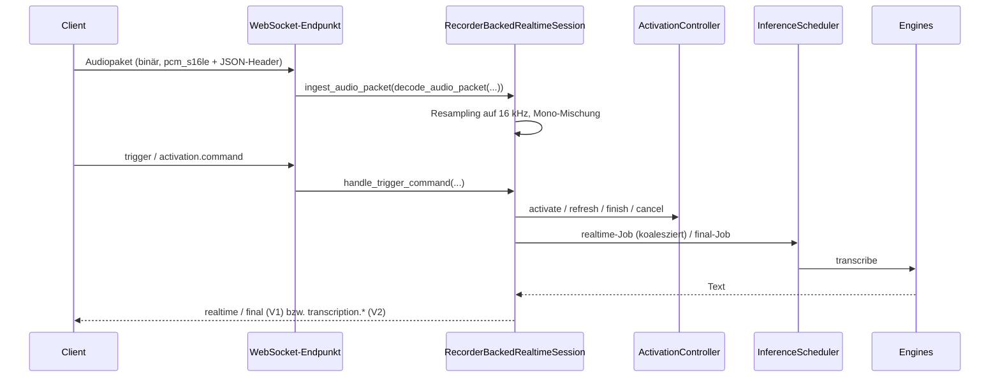

# 01 – System und Architektur

## 1. Pakete und ihre nachweisbaren Verantwortlichkeiten

`setup.py` (`packages=setuptools.find_packages(include=[...])`, ab Zeile 414)
installiert die folgenden Python-Pakete. Ihre Rollen ergeben sich aus den
Modulen und Importbeziehungen:

| Paket | Rolle im Code | Belege |
| --- | --- | --- |
| `voice_stt_server` | Öffentliche, schlanke Importfläche. Exportiert lazy `AudioToTextRecorder`, `AudioToTextRecorderClient`, `AudioInput`, `RealtimeSpeechBoundaryDetector`, `SpeechBoundaryEvent`, `SpeechBoundaryResult` aus `VoiceSTT`, dazu `get_version()`, `__version__`, `embedded_kroko()`, `embedded_kroko_variant()`. Der Import lädt bewusst weder Torch noch faster-whisper noch PyAudio. | `voice_stt_server/__init__.py`, `voice_stt_server/_embedded.py` |
| `VoiceSTT` | Bibliothekskern: Recorder (`audio_recorder.py`), Audioeingang, Kern-Bausteine unter `core/` (VAD, Wake-Word, Pre-Roll, Realtime-Stabilisierung, Boundary-Detektor), Transkriptions-Engines (`transcription_engines/`), Kroko-Native-Verwaltung (`kroko/`, `install_kroko.py`), Versionsautorität (`_version.py`) und Build-Identität (`_build_identity.py`). | `VoiceSTT/__init__.py`, `VoiceSTT/core/*`, `VoiceSTT/transcription_engines/factory.py` |
| `VoiceSTT_server` | Prozess-Einstieg und Server-Infrastruktur: `server.py` re-exportiert `main`, `create_app`, `ServerSettings` aus `api_fastapi_server.server`; dazu Modellverwaltung (`stt_model_management.py`), strukturiertes Event-Logging (`event_logging.py`), OpenAI-Kompatibilität (`openai_compat.py`), Laufzeitkonfigurationsspeicher (`operations.py`), Credential-Redaktion, sowie der eigenständige Alt-Server `stt_server.py` und CLI-Client `stt_cli_client.py`. | `VoiceSTT_server/server.py` |
| `api_fastapi_server` | Die FastAPI-Anwendung: HTTP-Routen, WebSocket-Endpunkte V1/V2/Logs, Sitzungsverwaltung, Scheduler, Aktivierungs-Zustandsmaschine (`activation.py`), Befehlsparser (`activation_commands.py`), Segment-Ledger, Wake-Admission, Settings-Control-Plane (`settings_control.py`), Sicherheitsfassade (`security/`), Protokoll V2 (`protocol_v2/`). | `api_fastapi_server/server.py:8817` (`create_app`) |

Zusätzlich enthält das Repository Bereiche, die **nicht** paketiert werden
(nicht in `find_packages`, per `prune engineering` / `prune examples` aus dem
sdist ausgeschlossen):

| Bereich | Inhalt |
| --- | --- |
| `engineering/tools/` | Build-, Distributions-, Qualifikations- und Entwicklerwerkzeuge (z. B. `build_production.py`, `build_distribution.py`, `release_candidate.py`, `qualify_build_identity.py`, `cpu_only.py`) |
| `engineering/release/` | Release-State-Machine, Preflight, RC-Manifest, Adapter; Root-Einstieg `release.py` (Seite 10) |
| `engineering/deployment/docker/` | `nginx.conf`, historischer Reparaturpfad `Dockerfile.pro-upgrade` |
| `engineering/deployment/vps/` | servergebundene VPS-Hilfen (Vor-V2-Buildpfad, keine Produktautorität) |
| `engineering/drafts/transcription_engines/` | fünf nicht unterstützte Engine-**Entwürfe**, ohne `__init__.py`, von keinem Produktcode importiert |
| `examples/` | Beispielanwendungen `app_browserclient`, `app_talk_with_llm`, `app_webserver` |
| `tools/`, `release_tooling/`, `build/vps/*.sh` | nur noch Kompatibilitätseinstiege, die auf `engineering/` weiterleiten (Seite 11) |

Am Root verbleiben funktionsnotwendige Einstiege: `setup.py`, `pyproject.toml`,
`MANIFEST.in`, `Dockerfile`, `docker-compose.yml`, `release.py`,
`build_identity_support.py` und `wakeword_package_resources.py` (beide von
`setup.py` importiert), `config.yaml`, sowie `build/` mit den kanonischen
Dateien `kroko-builder.Dockerfile` und `kroko-redistribution.json`.

## 2. Laufzeitkomponenten des Servers

`create_app(settings, scheduler_factory=None, recorder_factory=None)`
(`api_fastapi_server/server.py:8817`) baut genau eine FastAPI-Instanz:

1. Ermittelt die Laufzeitidentität (`protocol_v2.identity.resolve_runtime_identity`).
2. Lädt – falls `data_root_path` gesetzt ist – persistierte Werte aus
   `<data_root>/config/runtime.json` und überschreibt damit die
   Startwerte (außer abgeleiteten Pfaden, `admin_api_key`, `openai_api_key`,
   `data_root_path`).
3. Prüft `ServerSettings.__post_init__` erneut und erzwingt die
   CPU-/Speicher-Modellrichtlinie (`enforce_cpu_model_policy`).
4. Erzeugt `ConnectionManager` und `VoiceSTTService`.
5. Startet den Dienst im FastAPI-`lifespan` (`service.start(loop)`) und stoppt
   ihn dort wieder; ein Fehler beim Stoppen wird geloggt, überdeckt aber keinen
   ursprünglichen Fehler.
6. Registriert die Routen (Seite 06) und die WebSocket-Endpunkte (Seite 07).

Wichtige Klassen in `api_fastapi_server/server.py`:

| Klasse | Zeile | Aufgabe (aus Code abgeleitet) |
| --- | --- | --- |
| `ServerSettings` | 428 | Dataclass aller Servereinstellungen inkl. abgeleiteter Logpfade |
| `ConnectionManager` | 1716 | V1-Verbindungen je `session_id`, Versand an Sitzungen |
| `FairInferenceQueue` | 1780 | Faire Warteschlange: je Sitzung eine Final-Deque und **ein** Realtime-Slot |
| `SharedEngineWorker` | 1966 | Worker-Thread, der Jobs einer Queue auf einer Engine ausführt |
| `InferenceScheduler` | 2135 | Hauptqueue + optionale Realtime-Queue, Modus `balanced-main-plus-realtime` oder `low-memory-one-model` |
| `RecorderBackedRealtimeSession` | 2332 | Eine Client-Sitzung: Audioaufnahme, Aktivierung, Realtime/Final-Jobs, Ereignisse |
| `SessionStore` | 6157 | Sitzungsregister, Zähler aktiver Sprecher |
| `VoiceSTTService` | 6264 | Zentrale Dienstinstanz: Settings, Modelle, Scheduler, Sitzungen, Sicherheit, Events |

## 3. Datenfluss einer Sitzung

Belege: `VoiceSTTService.packet_to_server_samples` (`server.py:7677`),
`RecorderBackedRealtimeSession.ingest_audio_packet` (`server.py:3035`),
`handle_trigger_command` (`server.py:3524`), `FairInferenceQueue.submit`
(`server.py:1795`).

## 4. Nebenläufigkeit

- Inferenz läuft in Worker-Threads (`SharedEngineWorker`), nicht im
  ASGI-Eventloop. Blockierende Admin-Operationen (Modelle laden/entladen/
  wechseln, Kroko-Lizenzprüfung, Modell-Refresh) werden per
  `asyncio.to_thread` ausgelagert (`server.py:8968–9115`).
- Der V2-Endpunkt entkoppelt Domänen-Threads vom Eventloop über eine
  `asyncio.Queue` und `loop.call_soon_threadsafe` (`server.py:10123ff.`,
  Funktion `sink`). Ein separates `transport_close`-Event weckt den
  Empfangspfad, wenn die Domäne die Verbindung schließen will.
- Die Kroko-Force-Community-Änderung und die Job-Annahme teilen sich
  `service._kroko_policy_lock` (Kommentar und Code in
  `patch_settings_server_v2`, `server.py:9246ff.`).
- `RuntimeConfigStore` schreibt atomar (`temp file -> os.replace`) unter einem
  modulweiten Lock (`VoiceSTT_server/operations.py:400ff.`).

## 5. Geräte- und Plattformgrenzen

- **Nur CPU:** `effective_device` wirft für alles außer `cpu`
  (`server.py:8728`); `create_transcription_engine` setzt `config.device =
  "cpu"` (`VoiceSTT/transcription_engines/factory.py`); die YAML-Konfiguration
  lehnt `device != cpu` ab (`load_yaml_config_defaults`). Die CLI erlaubt nur
  `--device cpu`.
- **Server-Samplerate:** `SERVER_SAMPLE_RATE = 16000` (`server.py:147`).

## Primäre Quellen

- [`api_fastapi_server/server.py`](../../api_fastapi_server/server.py) – `create_app` (8817), Klassen siehe Tabelle
- [`VoiceSTT_server/server.py`](../../VoiceSTT_server/server.py) – Re-Export des Einstiegs
- [`voice_stt_server/__init__.py`](../../voice_stt_server/__init__.py) – öffentliche Importfläche
- [`setup.py`](../../setup.py) – Paketliste
- Tests: [`tests/unit/test_fastapi_server_multi_user.py`](../../tests/unit/test_fastapi_server_multi_user.py), [`tests/unit/test_server_info.py`](../../tests/unit/test_server_info.py), [`tests/compatibility/test_client_v2_identity.py`](../../tests/compatibility/test_client_v2_identity.py)
