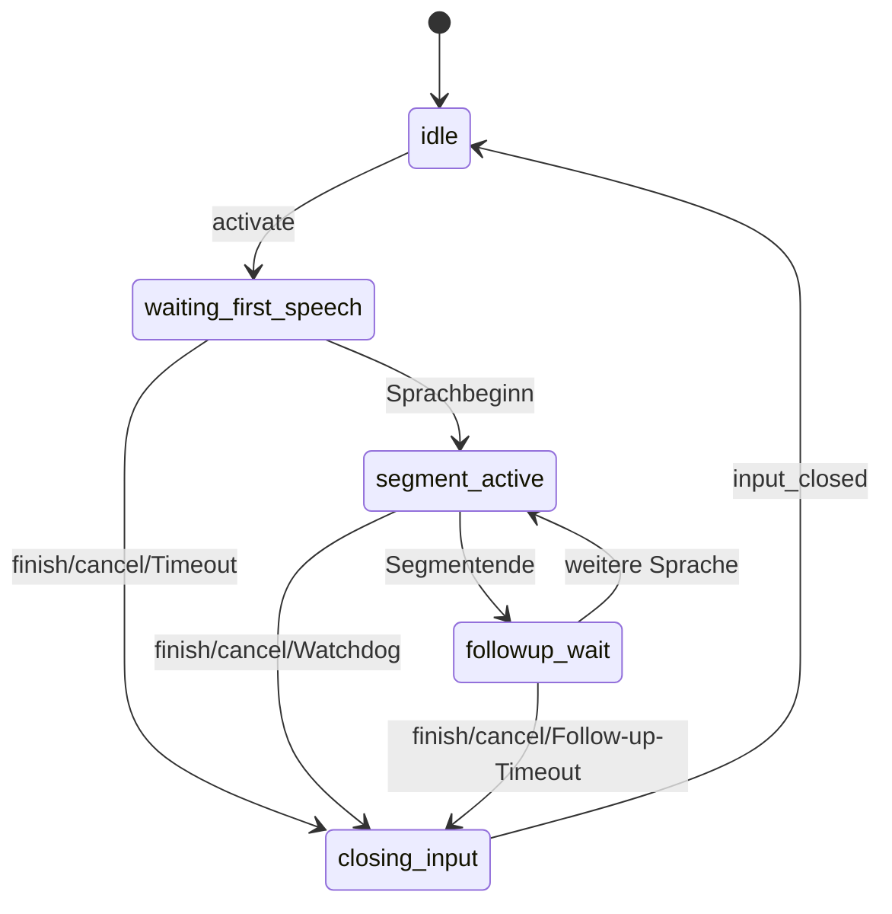

# 05 – Audio, Trigger und Wake-Word

## 1. Audioeingang über WebSocket

Beide Transkriptions-WebSockets (`/ws/transcribe`, `/ws/v2`) erwarten Audio als
**Binärframe** im selben Format (`api_fastapi_server/protocol.py`):

```text
+----------------------+-----------------------------+----------------------+
| uint32 little-endian | JSON-Metadaten (UTF-8)      | PCM-Nutzdaten        |
| Länge der Metadaten  | Objekt, höchstens 64 KiB    |                      |
+----------------------+-----------------------------+----------------------+
```

Prüfungen (`decode_audio_packet`, `VoiceSTTService.packet_to_server_samples`,
`server.py:7677`):

| Feld / Regel | Bedeutung |
| --- | --- |
| `sampleRate` | **Pflicht**, positive Ganzzahl |
| `channels` | optional, Default `1`, positive Ganzzahl ≤ 8 |
| `format` | optional, Default `pcm_s16le`; andere Werte werden abgelehnt |
| `frames` | optional; wenn vorhanden, muss `frames * channels * 2` exakt der Nutzdatenlänge entsprechen |
| Nutzdaten | ≤ `max_audio_packet_bytes` (Default 524288), an vollständigen Frames ausgerichtet |

Mehrkanal-Audio wird gemittelt (Mono), anschließend auf 16 kHz resampelt
(`resample_int16`, `SERVER_SAMPLE_RATE = 16000`).

Beispiel (Python, entspricht `encode_audio_packet`):

```python
import json, struct
meta = json.dumps({"sampleRate": 16000, "channels": 1, "format": "pcm_s16le"},
                  separators=(",", ":")).encode("utf-8")
frame = struct.pack("<I", len(meta)) + meta + pcm_bytes
```

Fehlerverhalten: V1 antwortet mit `{"type": "error", "where": "audio_packet",
...}` bzw. `{"type": "warning", ...}` bei abgelehntem Abschnitt; V2 verwirft
ungültige Pakete still (Debug-Log) und schließt mit `4400`, wenn vor
`hello.accepted` Binärdaten eintreffen (`ProtocolV2Connection.handle_binary`).

## 2. Erkennung von Sprachbeginn und -ende

Die Sitzung baut pro Verbindung einen `AudioToTextRecorder`
(`RecorderBackedRealtimeSession._create_recorder`, `server.py:2761`) mit
`use_microphone = False`. Relevante Einstellungen:

| Einstellung | Default | Wirkung |
| --- | --- | --- |
| `silero_sensitivity` | 0.05 | Silero-VAD-Empfindlichkeit (ONNX-Backend `VoiceSTT/core/silero_vad.py`) |
| `webrtc_sensitivity` | 3 | WebRTC-VAD-Aggressivität |
| `vad_energy_threshold` | 250.0 | Energieschwelle |
| `post_speech_silence_duration` | 0.55 s | Stille bis Segmentende |
| `min_length_of_recording` | 0.2 s | Mindestlänge |
| `min_gap_between_recordings` | 0.0 s | Mindestabstand |
| `early_transcription_on_silence` | 0.2 s | frühe Final-Transkription bei Stille |
| `pre_recording_buffer_duration` | 0.75 s | Pre-Roll vor erkanntem Sprachbeginn (`VoiceSTT/core/preroll.py`) |

## 3. Aktivierungsmodell

### Legacy- vs. kontrollierter Modus (V1)

`resolve_session_activation_config` (`server.py:1177`):

- Sendet der V1-Client **keinen** der Query-Parameter `manualTriggerEnabled`
  / `wakeWordTriggerEnabled`, läuft die Sitzung im Modus `legacy`
  (Aufnahme per `start`/`stop`, Wake-Word gemäß Profil).
- Sobald einer gesetzt ist, ist die Sitzung `controlled`; der fehlende Wert
  zählt als `false`. Beide `false` → Fehler `activation_trigger_required`.
  Nur Wake-Word aktiv, aber kein Wake-Word-Profil → Fehler
  `activation_wake_word_unavailable`.
- Akzeptierte Wahrheitswerte: `true|1|yes|on` bzw. `false|0|no|off`.

V2 kennt nur den kontrollierten Modus; die Trigger kommen aus
`hello.requestedSession.trigger` (Seite 07).

### Phasen

Fünf kanonische Vordergrundphasen (`api_fastapi_server/activation.py:65ff.`,
gespiegelt in `protocol_v2/schema.py:INPUT_PHASES`):



Finale Transkription ist **keine** Phase: Nach dem Schließen des Eingangs geht
der Vordergrund auf `idle`, ältere Final-Jobs laufen im `SegmentLedger` weiter
(`api_fastapi_server/segment_ledger.py`).

### Aktionen und Quellen

- Aktionen: `activate`, `refresh`, `finish`, `cancel`
  (`activation_commands.ACTIVATION_ACTIONS`). Das frühere `extend` ist auf
  beiden Transporten **unbekannt** (`invalid_action` in V1,
  `invalid_payload` in V2; Test
  `test_the_deprecated_v1_extend_spelling_is_unknown_on_both_wires`).
- Quellen: `manual`, `wake_word`. Der V1-Parser akzeptiert beide als
  `source` für `activate`; V2 erlaubt Clients nur `manual`
  (`schema.CLIENT_SOURCES`), `wake_word` entsteht ausschließlich serverseitig.
- `activate` darf keine `activationId` tragen; `refresh|finish|cancel`
  adressieren eine laufende Aktivierung.

### Timer (Defaults in `activation.py:93ff.`)

| Deadline | Default | Regel (Moduldocstring `activation.py`) |
| --- | --- | --- |
| `initial_speech` | 15 s | ab Aktivierung; `refresh` ist hier `invalid_phase` |
| `followup` | 3 s | nach Segmentende und bei jedem `refresh`, nicht kumulativ |
| `segment_watchdog` | 600 s initial, Refresh 180 s, Warnung 30 s vorher | ab Segmentbeginn; VAD setzt ihn nicht zurück |
| `closing_recovery` | 5 s | beim Eintritt in `closing_input` |

Deadlines sind monoton (keine Wanduhr). Ein Timer-Callback trägt ein
`TimerToken`; passt es nicht mehr zur aktuellen Aktivierung, ist es wirkungslos.
V1 kann die Werte per Query (`initialSpeechTimeout`, `followupTimeout`,
`segmentWatchdog*Seconds`, `closingRecoveryTimeoutSeconds`; Bereich
0.01–3600 s) setzen; in V2 steuert sie die Settings-Registry
(`activation.*Ms`, Seite 03).

### Befehls-Idempotenz

Jeder Befehl braucht eine `commandId`. Die Sitzung hält **einen**
Replay-Cache (`CommandReplayCache`): gleiche `commandId` + gleiche Nutzlast →
identische gespeicherte Antwort; gleiche `commandId` + andere Nutzlast →
`command_id_conflict` ohne Wirkung (`handle_trigger_command`,
`server.py:3524`).

### Audio-Verfügbarkeit

`audio_availability` (V1) bzw. `audio_availability.set` (V2) mit
`audioAvailable: bool`. `false` bricht eine offene Aktivierung ab; Sitzung und
Ledger bleiben erhalten (`handle_audio_availability_command`,
`server.py:3754`).

## 4. Wake-Word

### Katalog

`WakeWordCatalogAuthority` (`VoiceSTT/core/wakeword_catalog.py:1147`) ist die
einzige Autorität dafür, welche Wake-Words der Build anbietet. Quelle ist
`VoiceSTT/assets/wakeword_models/models.json` mit 25 Einträgen (u. a.
`alexa`, `computer`, `hey_jarvis`, `hey_mycroft`, `hey_nova`, `stop`,
`timer`, `weather`). Dateien, die nicht im Manifest stehen, werden nie zur
Build-Fähigkeit. Ein Refresh baut einen kompletten Kandidaten und tauscht nur
bei vollständigem Erfolg; sonst bleibt der letzte gute Katalog erhalten.

Beobachtet (`GET /api/v2/wake-words`): `catalogRevision: 2`; je Eintrag
`id`, `displayName`, `aliases`, `artifactVersion`, `available`,
`backends.onnx.available: true`, `backends.tflite.available: false`
(`unavailableReason: "runtime_unavailable"` in der lokalen Umgebung ohne
TFLite-Runtime).

### Erkennungspipeline

Aus dem Moduldocstring von `api_fastapi_server/wake_admission.py`:

```text
Prediction-Frames
  -> WakeHitTracker          (Schwelle, Mindestlauf, Hinterkante)
  -> WakeDetectionEvaluator  (Latch, Operator-Cooldown)
  -> WakeAdmissionCoordinator
  -> ActivationController.activate(source="wake_word")
```

- Eine zusammenhängende Folge von Frames über der Schwelle ist **ein**
  `WakeHit`; daraus entsteht höchstens ein `wakeword.detected`
  (`VoiceSTT/core/wake_detection.py`).
- `LogicalWakeEventLedger` mintet je akzeptierter `activationId` genau ein
  logisches Ereignis.
- `WakeAudioBoundary` (`VoiceSTT/core/wake_audio_boundary.py`) bestimmt, ab
  welchem Sample der Transkriptionstext beginnen darf, statt pauschal
  `wake_word_buffer_duration` abzuschneiden.

### Konfiguration

- Server-Default über `--wakeword-backend`/`--wake-words` (setzt bei Angabe von
  Wake-Words automatisch `openwakeword`), `--wake-words-sensitivity` (0.5),
  `--wake-word-timeout` (5.0 s), `--wake-word-buffer-duration` (0.1 s),
  `--wake-word-followup-window` (0.0 s), `--openwakeword-inference-framework`
  (`onnx`).
- Admin-HTTP: `GET/PUT /api/wake-word`. Als Backend akzeptiert `PUT` nur
  `openwakeword`, `open_wakeword`, `oww`; `sensitivity` 0–1; Zeiten ≥ 0;
  unbekannte Wake-Words → `400` mit `unavailableWakeWords`.
- V1-Sitzung: Query-Parameter `wakeWordEnabled` (`true|false|null|inherit`),
  `wakeWordBackend`, `wakeWords`, `wakeWordInferenceFramework`,
  `wakeWordSensitivity` (0–1), `wakeWordActivationDelay` (0–3600),
  `wakeWordTimeout` (0–3600), `wakeWordBufferDuration` (0–60),
  `wakeWordFollowupWindow` (0–3600) (`SESSION_WAKE_WORD_TUNING_FIELDS`,
  `server.py:594`).
- V2-Sitzung: `requestedSession.wakeWordIds` im `hello`, danach
  `wakeWord.*`-Settings (Seite 03). Werte mit `calibration: "pending"` sind im
  Code ausdrücklich als nicht kalibriert markiert.
- Server-weit abschaltbar über `wakeWord.globalDisabledIds` (Admin).

### Laufzeit-Unterdrückung

`runtimeSuppression.manual` / `runtimeSuppression.wakeWord` (V2-Hello und
`trigger_suppression.set`) sperren eine Quelle, ohne die Sitzungskonfiguration
zu ändern; unterdrückte Trigger werden mit `trigger_suppressed` quittiert und
erzeugen `activation.trigger_suppressed`.

## Primäre Quellen

- [`api_fastapi_server/protocol.py`](../../api_fastapi_server/protocol.py) – Audiopaketformat
- [`api_fastapi_server/activation.py`](../../api_fastapi_server/activation.py) – `ActivationController`, Phasen, Timer
- [`api_fastapi_server/activation_commands.py`](../../api_fastapi_server/activation_commands.py) – `prepare_activation_command`, Replay-Cache
- [`api_fastapi_server/wake_admission.py`](../../api_fastapi_server/wake_admission.py), [`VoiceSTT/core/wake_detection.py`](../../VoiceSTT/core/wake_detection.py), [`VoiceSTT/core/wakeword_catalog.py`](../../VoiceSTT/core/wakeword_catalog.py), [`VoiceSTT/core/wake_audio_boundary.py`](../../VoiceSTT/core/wake_audio_boundary.py)
- [`api_fastapi_server/server.py`](../../api_fastapi_server/server.py) – `parse_session_wake_word_query` (679), `resolve_session_activation_config` (1177), `packet_to_server_samples`
- Tests: [`tests/unit/test_server_activation_controller.py`](../../tests/unit/test_server_activation_controller.py), [`tests/unit/test_server_activation_commands.py`](../../tests/unit/test_server_activation_commands.py), [`tests/unit/test_server_command_timer_e2e.py`](../../tests/unit/test_server_command_timer_e2e.py), [`tests/unit/test_wake_detection.py`](../../tests/unit/test_wake_detection.py), [`tests/unit/test_wake_admission.py`](../../tests/unit/test_wake_admission.py), [`tests/unit/test_wakeword_catalog.py`](../../tests/unit/test_wakeword_catalog.py), [`tests/unit/test_wake_audio_boundary.py`](../../tests/unit/test_wake_audio_boundary.py), [`tests/unit/test_preroll.py`](../../tests/unit/test_preroll.py), [`tests/unit/test_silero_vad_backend.py`](../../tests/unit/test_silero_vad_backend.py), [`tests/unit/test_protocol_v1_v2_boundary.py`](../../tests/unit/test_protocol_v1_v2_boundary.py)
