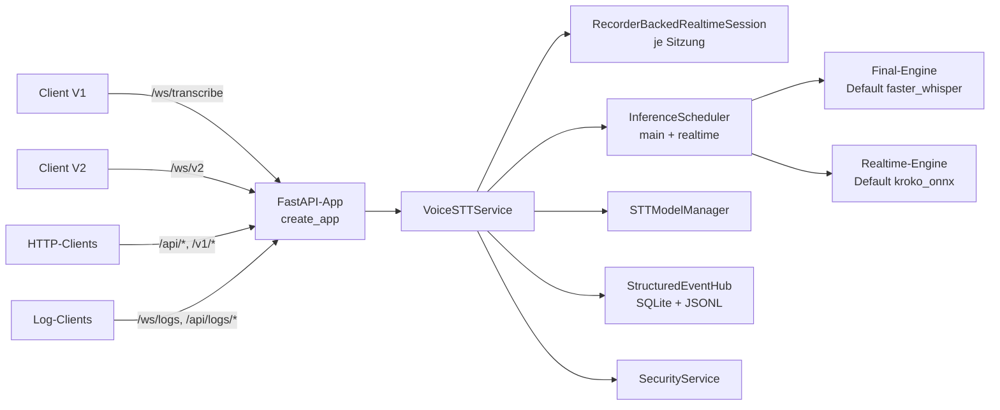

# Voice-STT-Server V2 – Code-Referenz

Diese Referenz beschreibt den **implementierten** V2-Stand des Repositorys
`voice-stt-server` auf dem Branch `feat/v2-release-cleanup` (abgezweigt von
`feat/einheitliche-triggerarchitektur-distributed` @ `4f30c0f`). Sie ist
ausschließlich aus Quellcode, Tests, ausführbarer Konfiguration
(`setup.py`, `Dockerfile`, `docker-compose.yml`, `config.yaml`,
GitHub-Workflows) und eigenen lokalen Läufen abgeleitet. Bestehende
Projektdokumentation wurde **nicht** als Quelle verwendet.

## Geltung und Lesart

- **Belegt** heißt: mindestens eine konkrete Code-, Test- oder
  Konfigurationsstelle ist am Seitenende bzw. im Text genannt.
- **„Im Code nicht eindeutig nachweisbar“** markiert Stellen, an denen
  bewusst keine Aussage getroffen wird.
- **Beobachtet** heißt: lokal am 2026-11-05 mit Python 3.12 ohne
  Modelldateien ausgeführt (`voice-stt-server --host 127.0.0.1 --port 8765
  --data-root <tmp> --no-model-warmup`). Es wurde kein Netzwerkdienst und kein
  Produktionssystem berührt.
- Zeilennummern beziehen sich auf den Stand dieses Branches und können bei
  späteren Änderungen wandern; Symbolnamen sind stabiler.

## Inhaltsverzeichnis

| Nr. | Seite | Inhalt |
| --- | --- | --- |
| 01 | [System und Architektur](01_system_und_architektur.md) | Pakete, Verantwortlichkeiten, Datenfluss, Nebenläufigkeit |
| 02 | [Installation und Betrieb](02_installation_und_betrieb.md) | Python-Version, Extras, CLI-Einstiege, lokaler Start, Docker |
| 03 | [Konfiguration und Settings](03_konfiguration_und_settings.md) | `ServerSettings`, CLI/YAML/Env-Vorrang, Laufzeitänderungen, V2-Settings-Registry |
| 04 | [Transkription und Modelle](04_transkription_und_modelle.md) | Engines, Final/Realtime, Scheduler, Modellverwaltung |
| 05 | [Audio, Trigger, Wake-Word](05_audio_trigger_wakeword.md) | Audiopakete, Aktivierung, Phasen, Timer, Wake-Erkennung |
| 06 | [HTTP-/REST-API](06_http_rest_api.md) | Alle Routen mit Auth, Ein-/Ausgaben, Fehlern |
| 07 | [WebSocket-Protokolle](07_websocket_protokolle.md) | `/ws/transcribe` (V1), `/ws/v2`, `/ws/logs` |
| 08 | [Authentisierung und Kroko](08_authentisierung_und_kroko.md) | Admin-, OpenAI-, Log-Zugriff, Kroko-Lizenz und Native-Guard |
| 09 | [Events, Logs, Persistenz](09_events_logs_persistenz.md) | Eventkanäle, SQLite-Store, Redaktion, Laufzeitkonfiguration |
| 10 | [Build, CI und Release-Technik](10_build_ci_und_release_technik.md) | Wheel, Container, Workflows, Release-State-Machine |
| 11 | [Entwickler, Tests, Debugging](11_entwickler_tests_debugging.md) | Modultopologie, Testauswahl, Erweiterungspunkte, Fehlerbilder |
| 12 | [Feature- und Quellenmatrix](12_feature_und_quellenmatrix.md) | Feature → Implementierung → Test → Status |
| 13 | [Anhang: V1-Nachrichten und Recorder-Parameter](13_anhang_v1_nachrichten_und_recorder.md) | maschinell erzeugte Feld- und Parameterreferenz |

## Lesepfade

- **Betrieb:** 02 → 03 → 06 → 08 → 09.
- **Client-Entwicklung:** 07 → 05 → 06 → 03 (Abschnitt V2-Settings).
- **Server-Entwicklung:** 01 → 11 → 04 → 05 → 12.
- **Release/Packaging:** 10 → 02 → 08 (Abschnitt Kroko).

## Kurzüberblick

## Primäre Quellen

- [`api_fastapi_server/server.py`](../../api_fastapi_server/server.py) – `create_app`, `ServerSettings`, `parse_args`, `main`
- [`setup.py`](../../setup.py) – Pakete, Extras, `console_scripts`
- [`tests/unit/test_v2_code_reference.py`](../../tests/unit/test_v2_code_reference.py) – mechanische Prüfung dieser Referenz
